# CineSmart-Product-Requirements-and-System-Design

# Movie Website

Status: In progress

**Last backend alignment:** 2026-10-12. This document reflects the decisions in `change.md` (Q1–Q28) and the backend as built in `implementation-plan.md` (Phases 0–8). Where an older section and a newer one disagree, the sections marked *(as built)* win.

### About project

This project is a Canada-focused movie discovery website. Users can browse what’s trending, explore titles by different filters (genre, year, language), and see **where to watch** each title in Canada with availability info and platform link . Logged-in users get personal features like watchlists, watched history, ratings, and recommendations.

**Watchable content note:** Movies and TV shows are treated as a single “watchable content” entity in the system (even if the UI is movie-focused).

- [x]  Build ETL Pipline
- [x]  Design Backend Architecture
- [x]  Design Movie Boundry
- [x]  Design and Implement Search Boundary
- [x]  Design and Implement IAM Boundary
- [x]  Design and Implement User Action boundry
- [x]  Design and Implement User Recommendation Engine
- [x]  Initial Backend Testing Via Postman

## Key features

### 1) Scope & region

- The website operates in **Canadian Info platform** (all availability is Canada-based and “Top trending titles ” are updated daily through TMDB API).
- Used the **Watchmode API** to show streaming availability in Canada.
- TMDB and OMDB To gather movie specific details and discovery

### 2) Home & landing experience

- Fully responsive for desktop, tablet, and mobile.
- landing page on any device:
    - enter the main experience without signing in
    - Brief intro explaining what the website offers to attract customer to explore more.
    - **Sign Up** /**Sign In** buttons.
    - Search bar which accepts the text min 3 char more detail in detailed spec
    - And Browse option menu which it self has different option such as all movies on platform, filter options like genre, language an year

### 3) Home page (non-logged-in)

*(as built)* `GET /api/v1/home` returns the rows below, in this order (public, JWT optional):

| Order | Key | Title | Source | "See more" endpoint |
|---|---|---|---|---|
| 0 | `for-you` | For You (logged in only) | Recommendation | `GET /recommendations` |
| 1 | `trending` | Trending Now | `top10` table (updated daily by the ETL), shown by IMDb rating desc | `GET /movies/trending` |
| 2 | `top-rated` | Top Rated by CineSmart Users | `weighted_rating` desc, `rating_count ≥ 5` | `GET /movies/top-rated` |
| 3 | `most-liked` | Most Liked | `like_count` desc (`like_count > 0`) | `GET /movies/most-liked` |
| 4 | `imdb-top-250` | IMDb Top 250 | `imdb_rating` desc, `imdb_votes ≥ 25,000`, max 250 (from stored data only) | `GET /movies/imdb-top-250` |

- Each row shows up to 10 movie cards, plus `totalResults` (the full size of its "see more" list).
- **No duplicates on home:** rows are filled in the order above; a movie already shown in an earlier row is skipped, and each row pulls extra candidates so it can still show 10. The "see more" endpoints are not de-duplicated.
- Empty rows are left out (for example Top Rated until 5 users have rated a movie).
- "Popular on platform" and "most rated" are not separate rows; Top Rated and Most Liked cover them.

```json
{ "sections": [
  { "key": "trending", "title": "Trending Now", "endpoint": "/api/v1/movies/trending",
    "totalResults": 10, "results": [ /* up to 10 MovieCards */ ] }
] }
```

### 4) Navigation & browsing

- Main navigation includes:
    - Search bar
    - Browse
        - All movies on platform
        - Browse by Year
        - Browse by Genre
        - Browse by Language
    - IMDb Top 250 (custom, data-driven)
- *(as built)* The Browse menu loads `GET /genres` and `GET /languages` once (IDs + names), shows the names and sends the clicked item's `id` to `GET /movies`. Years are a range picker on the frontend (e.g. 1920 → current year); there is no years endpoint.
- When not logged in: show **Sign In / Sign Up**.
- When logged in: show user-specific menu items such as watchlist tab should be added on main navigation and Profile table that allows user to see their info and logout option.

### 5) Authentication (accounts)

**Sign Up**

- Create an account with a username, email, and password
- Username: `^[A-Za-z0-9_.-]{3,32}$`; password: 8–100 characters; email: valid format
- Usernames and emails are unique **case-insensitively** (`John` = `john`). Emails are stored lowercased and trimmed; usernames keep the case as typed (display case)
- A username can't be changed once the account is created
- A verification email with a link is sent on signup (the link expires after 24 hours)
- The account stays inactive and cannot sign in until the email is verified
- The verification link opens the frontend page `/verify-email?token=…`, which POSTs the token to the backend and then goes to **Sign In** (no auto-login)

**Sign In form**

- Username + password login (verified accounts only); the username lookup is case-insensitive
- Link to Sign Up if not have account
- Link to reset a forgotten password
- Login responses *(as built)*:

| Situation | Response | Counts toward lockout? |
|---|---|---|
| Unknown username | 401 `Invalid username or password` | Yes |
| Wrong password (verified or unverified account) | 401 `Invalid username or password` | Yes |
| Correct password, account unverified | 403 `Account not verified` (frontend offers "resend verification") | No (password was correct) |
| Username currently locked | 429 `Too many failed attempts. Try again later.`, returned **without checking the password** | No (already locked) |
| Correct password, verified | 200 + tokens, failure counter cleared | — |

- The lock message appears whatever password is entered, so guessing during a lock is useless. It doesn't reveal whether the account exists, because unknown usernames get locked too.

**Password Reset**

- Available whether or not the user is logged in
- User enters their **email only** (case-insensitive); the response is the same 200 message in every case ("If an account exists for this email, we've sent instructions.")

| Account state | What is sent |
|---|---|
| No account with that email | Nothing |
| Account exists, verified | Password-reset link (expires after 10 minutes) |
| Account exists, unverified | Verification email (same as "resend verification") |

- The link opens the frontend page `/reset-password?token=…`, which shows the new-password form, POSTs it, then goes to **Sign In**
- The link is single-use and expires; a successful reset logs out every session of that user

**Abuse Protection** *(as built)*

- Per-IP rate limits (Redis fixed window; over the limit → 429 + `Retry-After`):

| Endpoint group | Limit per IP |
|---|---|
| `login` | 10 / min |
| `signup`, `password/forgot`, `email/resend`, `email/change`, `password/change` | 5 / 15 min |
| `email/verify`, `password/reset`, `email/change/confirm` | 10 / 15 min |
| Public browsing / search / `refresh` | 120 / min |

- Per-user rate limits: activity writes 60 / min (shared), `/me/**` and `/recommendations` reads 120 / min
- Failed-login lockout: 5 failures on a username → locked for 1 hour (Redis)
- IP block: 10 failed logins from one IP → that IP is blocked from **login only** for 1 hour; browsing still works
- The client IP is the connection address; `X-Forwarded-For` is trusted only when `app.trust-proxy=true` (set once a reverse proxy that overwrites it is in place)
- Logout invalidates the access token (Redis blacklist) and the refresh token

**Sessions** *(as built)*

| Token | Lifetime | Where it lives |
|---|---|---|
| Access JWT | 15 min | Frontend memory, sent as `Authorization: Bearer` |
| Refresh token | 2 h sliding (each refresh issues a new one and resets the 2 h) | `HttpOnly; Secure; SameSite=Strict` cookie, path `/api/v1/auth` |
| Absolute cap | 7 days from login | the user must log in again after it |

- A refresh token that is used twice is treated as theft: all of that user's sessions are revoked
- Password reset and password change log out other devices (change password keeps the current session)

**Profile, change password, change email** *(as built)*

- `GET /me` returns `userId, username, email, createdAt, watchlistCount, watchedCount, ratingCount`
- Change password: current password + new password (8–100, different from the current one); a wrong current password counts toward the lockout
- Change email: current password + new email (valid, unique case-insensitively). A verification link (24 h) goes to the **new** address (`/confirm-email?token=…`); the switch happens only when it is opened, and a "your email was changed" notice then goes to the old address
- Delete account is not included for now

### 6) Logged-in user menu

After login, include:

- Home
- Movies
    - All movies
    - Browse by Year
    - Browse by Genre
    - Browse by Language
- Search (title or person name; there is no separate browse by actor or director)
- My Watchlist
- Profile
- Logout

**For You (personalized feed)**

- A personalized *page/section* that shows a list of recommended movies after the user logs in is added ad placed on page as top of all general categories

### 7) Watchlist

- Add movies to a watchlist
- Remove items from the watchlist
- Display watchlist with posters (`GET /me/watchlist`, paginated, newest first)
- Show a small thumbnail/poster marker for already watched items (each watchlist card carries `watched`; `GET /me/watched` returns `[{movieId, watchedAt}]` for marking items elsewhere)
- If a non-logged-in user clicks **Add to Watchlist**, prompt them to **Sign In**

### 8) Already watched ( Not for display internal storage only)

- When user sees the movie detail if already watched then website shoud indicate user via a highlighted already watched button to indicate they marked it as such if not watched ten no highlight but allow user to toggle between already watched and not
- Mark a movie as watched
- Remove it from watched history
- store the date of watched movies (useful for recommendations)

### 9) Ratings & likes

- Users can rate movies (1–10, one decimal) and like or dislike them
- The reaction is `LIKE`, `DISLIKE` or `NEUTRAL`. **NEUTRAL is the default "no opinion" state**: a user with no reaction reads as NEUTRAL, setting NEUTRAL is allowed, and removing the reaction makes it NEUTRAL again
- Each user has at most one rating and one reaction per movie; submitting again updates the existing one (and its timestamp)
- Each user’s own rating and reaction are stored and shown immediately (every action returns the updated `userState`)
- Overall user rating, like count, and dislike count are calculated in batches (see Movie Analytics Aggregation), so they may lag by up to 1 hour
- Ratings and likes are inputs to recommendations

### 10) Popular vs personalized sections

- Non-logged-in users see the **Trending, Top Rated, Most Liked and IMDb Top 250** rows described in section 3.
- Logged-in users see all the usual lists plus a personalized **For You** section as the first list on home page

### 11) Recommendations

*(as built)* Personalized recommendations are:

- **For You** (logged in): one ranked list, `GET /recommendations`, shown first on the home page. Each item carries a short `reason`: "Because you liked X", "More with *Person*", "Matches your taste in *Genre*", or "Popular on CineSmart" for new users.
- **More like this** (everyone): similar titles on the details page (section 18).

For You considers the genres, languages, actors and directors of the movies the user rated highly, liked, watched or put on the watchlist. The algorithm is in the Recommendation section (Domain Rules).

**Removed:** separate "Because you liked X", "Based on your watchlist", "More starring this actor" and "Because you like this director" rows. Those signals feed the single For You list (and its `reason` text) instead.

### 12) Actor-based recommendations

- Removed as a separate row (see section 11). Actors and directors the user likes raise matching movies in For You, labelled "More with *Person*".

### 13) Search

The search bar matches *(as built)*:

- Movie title
- Person name (actor, director, writer): a match returns that person's movies

**Simple search flow:**

- User enters text
    
    ↓
    
- Backend determines matching data
    
    ↓
    
- Title or person → movies

**Matching:**

- Fuzzy matching using PostgreSQL trigram `word_similarity` (`pg_trgm`), so partial words match at the start, middle, or end
- `q` is required, 3–100 characters after trimming; anything else is rejected (400)
- A movie matches when `word_similarity(q, title)` or `word_similarity(q, person name)` for any of its people is ≥ 0.3 (setting `search.similarity-threshold`)
- Score = the best match, with a small boost (0.1) when the title matched; sorted by score, then IMDb votes
- No filters, no `sort` parameter and no search + filter combinations

**Flow:** User enters text → backend validates (3–100 characters) → trigram match against titles and person names → ranked movie cards → paginated response (`GET /movies/search?q&page&size`)

Examples:

- “Interstellar” → find the movie
- “Incep” → find the inception or related movie that matches keyword or contains the keyword

### 14) Search results

- Paginated: `page` 0-based (default 0), `size` 1–30 (default 20); invalid values → 400. This rule applies to every list endpoint
- Ordered by relevance; no user-chosen sorting or filters
- Results are movie cards (section 15); full details are loaded when a title is opened
- No matches → 200 with an empty page (never 404)
- Frontend should display 10 cards per row and allow user to see more titles as they click on arrow and on top should be indicator of total titles in that category row

### 15) Title cards (movie/TV show)

- Poster/thumbnail
- Clean design (hover can reveal title)
- Clicking opens the details page
- styled horizontal rows where appropriate
- Start with a limited number of items (e.g., 10)
- Arrow controls to browse more
- *(as built)* One `MovieCard` shape is used by every list, search result, home row and recommendation:

```json
{
  "movieId": 123, "title": "Interstellar", "year": 2014, "poster": "https://...",
  "imdbRating": 8.7,
  "averageRating": 8.4, "likeCount": 95, "dislikeCount": 6,
  "inWatchlist": true, "watched": false
}
```

- `averageRating`, `likeCount`, `dislikeCount` come from `movie_analytics`. `inWatchlist` / `watched` are filled for logged-in users with one batched lookup per page, and are `null` when anonymous.
- No plot, availability or genres on cards. `/me/watchlist` adds `addedAt`; `/me/ratings` adds `rating, ratedAt`; recommendations add `reason`.

### 16) Title details page

Show:

- Poster, title, release year, runtime, language, genres
- Plot/description
- Director, cast
- Studio/production company (if available)
- IMDb rating, Rotten Tomatoes rating (if available)
- User rating + number of user ratings/likes
- Country *(known gap: not in the database or API; country and awards are not returned for now)*
- Availability information (Canada)
- Watchlist button, watched button, rating/like controls

*(as built)* `GET /api/v1/movies/{id}` (public, JWT optional) returns everything for this page in one call:

```json
{
  "movieId": 123, "imdbId": "tt0816692", "title": "Interstellar", "year": 2014,
  "released": "2014-11-07", "runtime": 169, "plot": "...", "poster": "https://...",
  "contentType": "movie", "studio": "Paramount",
  "ratings": { "imdb": 8.7, "imdbVotes": 2100000, "rottenTomatoes": 73, "metascore": 74 },
  "genres":    [ { "id": 1, "name": "Sci-Fi" } ],
  "languages": [ { "id": 3, "name": "English" } ],
  "directors": [ { "personId": 9,  "name": "Christopher Nolan" } ],
  "writers":   [ { "personId": 9,  "name": "Christopher Nolan" } ],
  "cast":      [ { "personId": 20, "name": "Matthew McConaughey" } ],
  "platformStats": { "averageRating": 8.4, "ratingCount": 120, "likeCount": 95, "dislikeCount": 6 },
  "availability": [ { "platform": "Netflix", "type": "sub", "url": "https://..." } ],
  "userState": { "inWatchlist": true, "watched": false, "rating": 9.0, "reaction": "LIKE" }
}
```

- `userState` is `null` when anonymous; `reaction` is `"NEUTRAL"` when the user has none.
- Crew is split by `movie_role.role_name` (`Actor` → `cast`, `Director`, `Writer`); any future role goes to an `otherCrew` map. `boxOffice` is not returned.
- Unknown movie → 404 `MOVIE_NOT_FOUND`.

### 17) Where to watch

- Show streaming/platform availability as per movie card info as provided
- Display platform name and link when appropriate

### 18) Similar titles

At the bottom of each details page:

- Show similar movies ("More like this")
- *(as built)* `GET /api/v1/movies/{id}/similar?size=` (public, JWT optional; `size` default 10, max 30) returns a plain list of movie cards (not paginated)
- Score = `0.4·shared genres + 0.3·shared directors and cast + 0.1·same language + 0.2·(imdbRating/10)`, each part normalized 0–1; ties go to IMDb votes. The movie itself is excluded
- Logged in: the user's watched and disliked movies are also excluded
- A movie with genres but no people gets same-genre movies ranked mostly by IMDb rating; a movie with neither gets an empty list. Unknown movie → 404

## Data, backend, and infrastructure

**Design notes**

- `person.name` is unique by design. OMDb provides names only (no person IDs), so two different people with the same name are treated as one. Accepted limitation.
- `user_reaction.reaction` is `LIKE` / `DISLIKE` / `NEUTRAL`, with `reacted_at` set again on every change. NEUTRAL is the default "no opinion" state: no row and a NEUTRAL row mean the same thing, and removing a reaction deletes the row. (Replaces the earlier boolean `user_like` design.)
- `user_rating.rated_at` is set again on every rating change.
- `movie` is read-only for the Spring backend. Aggregate data lives in `movie_analytics`; the app writes only that table (plus the user tables).
- `movie_person` has no billing order (OMDb gives about 3 actors per movie), so "top billed cast" means all of a movie's `Actor` links.
- Usernames and emails are unique case-insensitively (unique indexes on `LOWER(username)` and `LOWER(email)`).
- Database changes are manual SQL migrations (`Database/Migration/V0xx__….sql`, no Flyway): each is `ALTER`-based, in one transaction, re-runnable, with pre-checks and undo SQL. The root `Cinesmart_database_schema.sql` is the up-to-date schema for a fresh install (`Database/Schema.sql` mirrors it); V001–V018 are history only.

### 19) Movie data system

- Use **OMDb API and TMDB API** as the external source for movie metadata.
- Build an ingestion process to retrieve, validate, clean, deduplicate, and store OMDb data.
- The website should read primarily from the **local database** (not call OMDb for every request).
- Support updates/synchronization without creating duplicates.

### 20) Database (entities)

Store:

- Movies
- Actors, directors
- Genres, languages
- Studios
- Ratings, awards
- Countries
- Streaming availability
- Users
- Watchlists
- Watched history
- User ratings/likes

### 21) Backend architecture

- Build the backend before the frontend.
- Use **Spring Boot**.
- Follow a clean **MVC** structure:
    - Controllers
    - Services
    - Repositories
    - Models/entities
- REST APIs for frontend communication, all under `/api/v1` (full table in "API Overview" below)
- Test APIs with Postman before starting the frontend
- Reads use JDBC (`NamedParameterJdbcTemplate`); JPA maps only `app_user`
- Secrets and environment-specific settings come from env vars (`SPRING_DATASOURCE_*`, `JWT_SECRET`, `MAIL_*`, `REDIS_*`, `FRONTEND_BASE_URL`, `FRONTEND_ORIGINS`); a `.env.example` lists them
- **CORS** *(as built)*, configured once in the security config so it also applies to filter-level 401/429 responses:

| Setting | Value |
|---|---|
| Allowed origins | env `FRONTEND_ORIGINS` (comma-separated), default `http://localhost:5173` |
| Methods | `GET, POST, PUT, DELETE, OPTIONS` |
| Allowed headers | `Authorization, Content-Type` |
| Credentials | `true` (needed for the refresh cookie) |
| Exposed headers | `Retry-After` |

- **Login and refresh response:** `{ "accessToken": "...", "expiresIn": 900, "user": { "userId": 42, "username": "Amir" } }`. The refresh token is only ever in the HttpOnly cookie, never in the body.

#### API Overview *(as built)*

| Area | Endpoints (`/api/v1`) | Access |
|---|---|---|
| Auth | `POST /auth/signup` (201) · `login` · `refresh` · `email/verify {token}` · `email/resend {email}` · `email/change/confirm {token}` · `password/forgot {email}` · `password/reset {token,newPassword}` | Public |
| Auth | `POST /auth/logout` (204) · `password/change {currentPassword,newPassword}` · `email/change {currentPassword,newEmail}` | Login required |
| Me | `GET /me` · `/me/watchlist?page&size` · `/me/watched` · `/me/ratings?page&size` · `/me/reactions` | Login required |
| Activity | `PUT` / `DELETE /movies/{id}/watchlist` · `/watched` · `/rating {rating}` · `/reaction {reaction}` → 200 `{inWatchlist, watched, rating, reaction}` | Login required |
| Catalog | `GET /movies/{id}` · `/genres` · `/languages` | Public, JWT optional |
| Discovery | `GET /home` · `/movies?genreId&languageId&year&page&size` · `/movies/search?q&page&size` · `/movies/trending` · `/movies/top-rated` · `/movies/most-liked` · `/movies/imdb-top-250` | Public, JWT optional |
| Recommendation | `GET /recommendations?page&size` | Login required |
| Recommendation | `GET /movies/{id}/similar?size` | Public, JWT optional |

- **Rules:** nouns, not verbs. `PUT` sets a state, so repeating it has no extra effect; `DELETE` removes it, and removing something already gone still succeeds. Both return the updated `userState`.
- **JWT optional** means an invalid or expired token on a public GET is treated as anonymous, not as a 401.
- There is no `/me/activity` and no `/movies/most-rated`.

### 22) Service separation

- Keep logic separated into clear modules where useful (a modular monolith; no microservices).
- *(as built)* Modules: `shared`, `identity`, `catalog`, `activity`, `analytics`, `discovery`, `recommendation` (see "System Architecture Boundaries").

### 23) PostgreSQL + ingestion pipeline

- Design the relational schema before building the backend.
- Use **PostgreSQL** as the primary database.
- Add relationships, constraints, foreign keys, and indexes.
- Ingestion pipeline should be repeatable and idempotent.
- Handle incomplete/failed data gracefully.

## Add-ons / future features

### 24) Redis (later optimization)

- **In use:** IP and per-user rate limiting, failed-login lockout and the login IP block, refresh tokens and session lists, the access-token blacklist and `tokens-valid-after`, and the hashed one-time tokens (verification, reset, change email)
- **Later (caching):** add Redis as a cache only after the PostgreSQL-backed system works correctly, never as a replacement for PostgreSQL
- Cache candidates:
    - Trending/top lists
    - Popular/top-rated lists
    - Frequently accessed title details
    - **Recommendation results** (planned: each user's For You ranking, 10 min TTL, cleared on any activity change by that user)
- Measure performance before/after.

### 26) Movie assistant (future)

After core functionality is complete:

- Add a chatbot/assistant that can answer natural-language questions using movie database and recommendation system.
- Example queries:
    - “Find me sci‑fi movies like Interstellar.”
    - “What movies has Tom Hanks acted in?”
    - “What should I watch based on my watchlist?”

### 27) Other future enhancements

- Add more categories and franchises
- Improve recommendations: **negative signals** (dislikes, ratings below 5 lowering the profile) and the Redis cache of recommendation results (section 24)
- Improve search
- Add more personalization
- Delete account
- Country and awards on the details page (needs schema and ETL work)

## Optional (nice-to-have) features to look out for (not required)

If you want to make the project more “internship-ready” later, these are great upgrades—but **not necessary** to finish the core product:

### A) Deployment & DevOps

- Dockerize services (app + database)
- Deploy to a cloud provider (AWS/GCP/Azure)
- CI/CD pipeline (e.g., GitHub Actions)
- Proper secrets/config management (env vars)
- Health checks + basic monitoring/logging (**next phase**: an Actuator health endpoint; today there is only a Redis `PING` at startup with one log line)

### B) Testing

**Next phase** after the current backend round (no automated tests exist yet):

- Unit tests (services): recommendation scoring, weighted rating, rate limiter, token hashing, validation
- Integration tests (controllers + database), e.g. with Testcontainers
- API contract tests (request/response schemas)
- Optional: simple load test for key endpoints

### D) Performance

- Verified database indexing for search and filtering
- Redis caching for high-traffic endpoints (only after measuring bottlenecks)

### E) Recommendation system quality

- Clearly documented recommendation approach (even if it’s not ML)
- Simple evaluation/metrics (what “better recommendations” means)

# Database

*(as built)* Matches `Cinesmart_database_schema.sql` (V001–V022 applied). `user_like` was replaced by `user_reaction`; `movie_analytics` has the batch-job columns; `movie.global_rating` / `global_reaction_count` were dropped by V022.

```mermaid
erDiagram
    movie {
        int64 movie_id PK
        varchar imdb_id UK
        int tmdb_id UK
        varchar title
        int16 year
        date released
        int16 runtime
        text plot
        text poster
        varchar content_type
        varchar studio
        int16 rotten_tomatoes
        int16 metascore
        numeric imdb_rating
        int64 imdb_votes
        numeric box_office
    }

    person {
        int64 person_id PK
        varchar name UK
    }

    movie_role {
        int64 role_id PK
        varchar role_name UK "Actor, Director, Writer"
    }

    movie_person {
        int64 movie_id "PK, FK"
        int64 person_id "PK, FK"
        int64 role_id "PK, FK"
    }

    genre {
        int64 genre_id PK
        varchar genre_name UK
    }

    movie_genre {
        int64 movie_id "PK, FK"
        int64 genre_id "PK, FK"
    }

    language {
        int64 language_id PK
        varchar language_name UK
    }

    movie_language {
        int64 movie_id "PK, FK"
        int64 language_id "PK, FK"
    }

    availability {
        int64 movie_id "PK, FK"
        varchar platform PK
        varchar availability_type
        text platform_url
    }

    top10 {
        int movie_id "PK, FK"
    }

    app_user {
        int64 user_id PK
        varchar username "UK, case-insensitive"
        varchar email "UK, lowercased"
        text password_hash
        boolean is_verified "default false"
        timestamptz created_at
    }

    watchlist {
        int64 user_id "PK, FK"
        int64 movie_id "PK, FK"
        timestamptz added_at
    }

    already_watched {
        int64 user_id "PK, FK"
        int64 movie_id "PK, FK"
        timestamptz watched_at
    }

    user_rating {
        int64 user_id "PK, FK"
        int64 movie_id "PK, FK"
        numeric rating "1-10"
        timestamptz rated_at "set on every change"
    }

    user_reaction {
        int64 user_id "PK, FK"
        int64 movie_id "PK, FK"
        varchar reaction "LIKE, DISLIKE, NEUTRAL"
        timestamptz reacted_at "set on every change"
    }

    movie_analytics {
        int64 movie_id "PK, FK"
        int rating_count
        numeric average_rating "NUMERIC(4,2), null if no ratings"
        numeric weighted_rating "NUMERIC(4,2), null if no ratings"
        int like_count
        int dislike_count
        timestamptz updated_at
    }

    movie ||--o{ movie_person : features
    person ||--o{ movie_person : participates_in
    movie_role ||--o{ movie_person : defines
    movie ||--o{ movie_genre : has
    genre ||--o{ movie_genre : classifies
    movie ||--o{ movie_language : has
    language ||--o{ movie_language : identifies
    movie ||--o{ availability : available_on
    movie ||--o| top10 : trending
    movie ||--o| movie_analytics : has_analytics
    app_user ||--o{ watchlist : maintains
    movie ||--o{ watchlist : appears_in
    app_user ||--o{ already_watched : records
    movie ||--o{ already_watched : is_watched
    app_user ||--o{ user_rating : submits
    movie ||--o{ user_rating : receives
    app_user ||--o{ user_reaction : submits
    movie ||--o{ user_reaction : receives
```



Tab 1

## 1. Product Definition

The system is a **movie database website** that allows users to discover movies, manage their personal movie-related information, and receive personalized movie recommendations.

The homepage displays movies in different sorted or categorized lists, such as:

- Language
- Genre
- Other relevant categories

The system also includes a recommendation engine that recommends movies based on individual user behavior.

---

---

---

Tab 2

# 2. Actors

## User

A user can interact with the system to:

- Sign up
- Log in
- Change their password
- Change their email
- View their profile
- Add movies to their watchlist
- Mark movies as already watched
- Rate movies
- Like movies
- Dislike movies
- Search for movies by:
    - Title
    - Person name
- Browse movies by:
    - Year
    - Genre
    - Language

## System

The system is responsible for:

- Validating all user inputs
- Providing appropriate responses
- Running the recommendation engine for a specific user
- Showing recommendations based on that user’s choices and behavior
- Keeping users’ data separated from other users’ data
- Preventing one user from accessing another user’s watchlist or similar private information
- Maintaining a platform average rating (`average_rating`) and a weighted rating for each movie
- Recomputing the platform ratings as more users rate the movie (hourly batch job)
- Maintaining the number of likes and dislikes for each movie
- Providing lists such as the most-liked movies for display on the homepage
- Maintaining a separate local rating system for the platform, independent of other external movie ratings

Tab 3

# 3. Non-Functional Requirements

The system should be:

## Secure

- Only valid users should be able to log in.
- A user cannot see another user’s personal data, watchlist, likes, or ratings.
- User-specific data should be kept private and isolated, while aggregate data can be shared across users.
- The backend identifies the user only from the access token (`userId` claim), never from client-supplied IDs.
- Passwords are hashed with BCrypt; verification, reset and change-email tokens are random 256-bit values stored only as SHA-256 hashes in Redis.
- Rate limits, lockout and the login IP block are described in "Abuse Protection" (section 5).

## Efficient

- Search and list endpoints should respond within **[target, e.g. 300 ms at the 95th percentile]** on the expected dataset.
- Search is supported by trigram indexes.
- Concurrent requests from different users are handled independently.

## Scalable

- Boundaries are separated so Recommendation can be extracted later if needed.
- Heavy aggregation is done in scheduled batches instead of per request.

## Equipped with Robust Input Validation

- The system should validate user input to prevent invalid or potentially malicious input.

## Capable of Providing Appropriate and Reliable Responses

- The system should provide appropriate responses for successful operations and failures.
- Responses should be reliable and consistent.

**Error format** *(as built)*: every error, including filter-level 401/403/429/503, uses one JSON shape:

```json
{ "status": 400, "code": "VALIDATION_FAILED", "message": "Invalid request fields",
  "path": "/api/v1/auth/signup", "timestamp": "2026-10-12T14:03:00Z",
  "fields": { "email": "must be a well-formed email address" } }
```

- `fields` appears only for validation errors. 500 errors never expose internals. Clients switch on `code`, not `message`.
- Codes: `VALIDATION_FAILED` (400), `BAD_REQUEST` (400), `TOKEN_INVALID` (400), `UNAUTHORIZED` (401), `INVALID_CREDENTIALS` (401), `FORBIDDEN` (403), `ACCOUNT_NOT_VERIFIED` (403), `EMAIL_TAKEN` (409), `USERNAME_TAKEN` (409), `MOVIE_NOT_FOUND` (404), `NOT_FOUND` (404), `METHOD_NOT_ALLOWED` (405), `ACCOUNT_LOCKED` (429), `RATE_LIMITED` (429, with `Retry-After`), `SERVICE_UNAVAILABLE` (503), `INTERNAL_ERROR` (500).
- Spring's own 4xx errors (unknown URL, wrong method, bad parameter, malformed JSON) keep their status and use this shape.

**Success format:** always JSON. Messages are `{ "message": "..." }`, never plain strings. Activity actions return 200 with the updated `userState`; logout returns 204; signup returns 201. Empty lists return 200 with `[]` or an empty page, never 204 or 404.

## Reliable When Redis Is Down *(as built)*

| Feature | Redis down → |
|---|---|
| Public browsing, search, details, home | Works (doesn't use Redis) |
| Rate limits (IP and per-user) | Fail **open**: the limit is skipped and a warning is logged |
| Access-token blacklist / `tokens-valid-after` check | Fail **open** (15-min tokens limit the exposure), warning logged |
| Login (lockout check) | Fail **closed**: 503 `SERVICE_UNAVAILABLE` |
| Refresh, signup, verify, resend, forgot, reset, change email/password | Fail **closed**: 503 |

- Redis calls have a short timeout (500 ms), so an outage doesn't hang requests.

Tab 4

## Define Detailed Use Cases / End-to-End Functional Workflows

## 1. Default Non-Logged-In Homepage

The homepage will show movies in different categories, which may be organized based on ratings, genre, language, and other relevant criteria.

All non-logged-in users and newly signed-up users will initially see the same default homepage.

Each movie thumbnail will display the movie poster. When the user hovers over a movie, the movie title and an **Add to Watchlist** button will be displayed.

- If the user is logged in, clicking **Add to Watchlist** will allow them to add the movie to their watchlist.
- If the user is not logged in, clicking **Add to Watchlist** will redirect them to the login page.

The default homepage will remain the same for all non-logged-in users and will only change when a user logs in.

A non-logged-in user can:

- View movie details.
- Search for movies.
- View movie information.

However, the **Add to Watchlist** button will redirect the user to the login page if they are not logged in.

For a logged-in user, additional options such as:

- Like
- Dislike
- Rate
- Add to Watchlist
- Mark as Already Watched

will be available.

The default homepage will load directly when anyone visits:

`CineSmart.ca/Home`

---

## 2. User Login

The user enters their username and password.

The frontend validates the input before sending it to the backend. The backend validates the data again.

Once validated:

*(as built)*

1. The backend checks the IP rate limit (10 / min) and the login IP block.
2. It checks whether the username is currently locked (Redis). If locked → 429, **without checking the password**.
3. It finds the user by username (case-insensitive). If there is no such user, it still runs a dummy password check (equal timing) → 401 and the failure is counted.
4. It compares the entered password against the stored password hash. Wrong → 401 and the failure is counted (also for unverified accounts).
5. Only after the password matches, it checks the account is verified. Unverified → 403 `Account not verified` (not counted; the frontend offers "resend verification").

If the credentials match and the account is verified:

- The failed-attempt counters are cleared.
- The response contains the access token and the user (`userId`, `username`); the refresh token is set as an HttpOnly cookie.
- The user is redirected to the homepage.

Unknown username and wrong password return the same generic `Invalid username or password`. After 5 failed attempts the username is locked for 1 hour; after 10 failed attempts from one IP, that IP can't log in for 1 hour.

The login process can be terminated by the user by returning to the non-logged-in homepage.

A session is maintained with a 15-minute access token and a 2-hour sliding refresh token (7-day cap), see "Sessions" in section 5. On a 401 the frontend calls `POST /auth/refresh` once and retries; if refresh fails, it goes to Sign In. The backend identifies the user from the access token (user ID), never from client-supplied data.

---

## 3. User Signup

The user goes to the login page and selects the **Sign Up** option.

The signup form contains fields such as:

- Email
- Username
- Password

The user enters the required information.

The frontend validates the form data and displays an appropriate message if the data is invalid.

After frontend validation, the data is sent to the backend.

The backend performs its own validation and safely processes the submitted data.

The system then:

1. Checks that the username and email are not taken (case-insensitively): duplicate username → 409 `USERNAME_TAKEN`, duplicate email → 409 `EMAIL_TAKEN`.
2. Hashes the user’s password.
3. Creates a new user entry (email lowercased, username as typed, password hash, created timestamp) marked as unverified, and commits it.
4. Only then generates a verification token (24 h, stored hashed) and sends a verification email containing a link to `FRONTEND_BASE_URL/verify-email?token=…`. If sending fails, signup still succeeds and the user can use "resend verification".

After successful signup (201):

- The system displays a message asking the user to check their email to verify the account.
- The user is redirected to the login page (not a logged-in homepage).

When the user opens the verification link, the frontend page POSTs the token (`POST /auth/email/verify`), the account is activated, and the user is sent to Sign In. Verification is a POST, so email scanners that open links automatically can't verify accounts.

On the user’s first login, their homepage is the default homepage with logged-in functionality available.

---

## 4. Logged-In User Homepage

As soon as the user successfully logs in, their logged-in homepage is loaded.

The existing movie lists remain available, and:

- A new **For You** section is added as the first row (only when it has results).
- The login button changes to **Sign Out**.
- **Profile** and **Watchlist** menu items become available (already watched is not displayed as a list; it is shown as a marker on cards and on the details page).
- Every card shows the user's `inWatchlist` / `watched` flags.

The For You row is part of the same `GET /home` response when a valid access token is sent. It is page 0 of `GET /recommendations` (without the `reason` text); its "see more" endpoint is `/api/v1/recommendations`.

---

## 5. Logged-In User Movie Detail Page

The movie detail page will always display the movie along with options such as:

- Add to Watchlist
- Mark as Already Watched
- Rate
- Like
- Dislike

If the user has already performed an action for that movie, the system will display the user’s existing state instead of the default option.

For example:

- If the movie is already in the watchlist → show **Remove from Watchlist**.
- If the movie is already marked as watched → show **Remove from Already Watched**.
- If the user has already rated the movie → show their rating.
- If the user has liked or disliked the movie → show their current like/dislike state.

All of these operations should be implemented safely so that a user cannot overwhelm the database by repeatedly clicking buttons and generating excessive queries. *(as built)* The actions are idempotent `PUT`/`DELETE` calls, rate-limited per user (60 writes / min shared). The frontend disables or debounces each button while its request is in flight, updates the UI optimistically, and then sets the buttons from the `userState` in the response.

---

## 6. User Adds a Movie to the Watchlist

When the user clicks the **Add to Watchlist** button:

1. The movie ID is identified.
2. The user’s identity is identified by the backend through their authenticated session/request.
3. The request is sent to the backend.
4. The backend processes the request.
5. The backend checks the movie exists (unknown movie → 404 `MOVIE_NOT_FOUND`).
6. A mapping between the user and movie is created in the user watchlist table (`PUT /movies/{id}/watchlist`; repeating it keeps the original entry and timestamp).
7. A timestamp is stored for the watchlist entry.
8. The response is the updated `userState`, and the watchlist icon changes to **Remove from Watchlist**.

---

## 7. User Adds a Movie to Already Watched

When the user clicks the **Already Watched** option:

1. The movie ID is identified.
2. The user’s identity is identified by the backend.
3. The request is sent to the backend.
4. The backend processes the request.
5. A mapping between the user and movie is created in the user already-watched table (`PUT /movies/{id}/watched`).
6. A timestamp is stored for the entry.
7. The response is the updated `userState`.

---

## 8. User Likes or Dislikes a Movie

Only logged-in users will have the like/dislike functionality available on the movie detail page.

When the user clicks **Like** or **Dislike**:

1. The movie ID is identified.
2. The user’s identity is identified by the backend.
3. The selected state is sent to the backend: `PUT /movies/{id}/reaction {"reaction": "LIKE" | "DISLIKE" | "NEUTRAL"}`.
4. The backend processes the request.
5. The system creates or updates the corresponding `user_reaction` entry (one upsert).
6. The timestamp (`reacted_at`) and reaction are stored.
7. The response is the updated `userState`. The movie’s aggregate like/dislike counts are **not** updated here; the hourly analytics job recomputes them.

The database primary key on (`user_id`, `movie_id`) in `user_reaction` means only one entry can exist for the same user and movie.

If the user has already liked or disliked the movie:

- The existing entry is updated in the same upsert (`ON CONFLICT DO UPDATE`), so no separate existence check is needed.
- `DELETE /movies/{id}/reaction` removes the entry; the reaction then reads as NEUTRAL.

The button should also change its meaning based on the user’s current state.

For example, if the user has liked the movie, the interface can provide an option to change the state to dislike.

The implementation should also prevent a user from repeatedly clicking the button and overwhelming the database with excessive queries.

---

## 9. User Rates a Movie

Only logged-in users can rate a movie.

When the user submits a rating:

1. The movie ID is identified.
2. The user’s identity is identified by the backend.
3. The rating value is sent to the backend.
4. The rating is validated to ensure that it is a value between 1 and 10 with at most one decimal (`PUT /movies/{id}/rating {"rating": 8.5}`).
5. The backend processes the request.
6. The movie ID, user ID, timestamp, and rating are stored in the user rating table.

If the user has already rated the movie:

- The existing rating and `rated_at` are updated in the same upsert instead of creating another entry.
- The response is the updated `userState`.

---

## 10. User Removes a Movie from the Watchlist

When the user removes a movie from their watchlist:

1. The movie ID is identified.
2. The user’s identity is identified by the backend.
3. The corresponding user-movie watchlist entry is located.
4. The entry is deleted from the database.

---

## 11. User Removes a Movie from Already Watched

When the user removes a movie from their already-watched list:

1. The movie ID is identified.
2. The user’s identity is identified by the backend.
3. The corresponding user-movie entry is located.
4. The entry is deleted from the database.

---

## 12. User Updates a Movie Rating

When the user updates their rating for a movie:

1. The movie ID is identified.
2. The user’s identity is identified by the backend.
3. The existing user-movie rating entry is located.
4. The rating value is updated in the database.

---

## 13. User Browses Movies by Category

When a user clicks the **Movies** tab, a dropdown displays different movie categories, such as:

- All movies
- Movies by year
- Movies by language
- Movies by genre

*(as built)* The frontend loads `GET /genres` (sorted by name) and `GET /languages` (most movies first) once; both list only values that have at least one movie and are cacheable for 1 hour. Years are a frontend range picker.

When the user selects a category, the frontend calls `GET /movies` with the chosen filter, using the genre's or language's `id`:

- `genreId`, `languageId`, `year` are optional and combinable (AND); no filter = all movies
- Fixed order: `imdb_rating DESC NULLS LAST, imdb_votes DESC, movie_id`; there is no `sort` parameter
- Unknown parameters, an unknown or invalid `genreId` / `languageId`, or a year outside 1888–2100 → 400. A valid year with no movies → empty page

The results are returned as a page of movie cards and displayed to the user.

---

## 14. User Searches for a Movie

When a user clicks the search bar, they can enter information such as:

- Movie title
- Person name (actor, director, writer)

The search request is sent to the backend (`GET /movies/search?q&page&size`).

The backend searches the movie database using the provided title, name or partial keyword and retrieves the relevant results.

1. The frontend and backend both require 3–100 characters (after trimming).
2. The backend runs a fuzzy trigram match against titles and person names (threshold 0.3, small title boost).
3. Results are ranked by score, then IMDb votes, and returned as paginated movie cards.
4. Selecting a result opens the movie details page, which loads the full movie from Movie Catalog.

---

## 15. Recommendation System

The recommendation system provides a **For You** section for logged-in users (`GET /recommendations?page&size` and the first row of `/home`).

The system considers the genres, languages, actors and directors of the movies the user engaged with positively.

The user data considered by the recommendation system:

1. User ratings (only ratings of **7 or higher** carry weight)
2. User likes
3. Watched movies
4. Watchlist entries

Dislikes don't lower the profile (negative signals are a future enhancement), but disliked movies are never recommended. The full algorithm is in the Recommendation section (Domain Rules).

---

## 16. IMDb Top 250 Category

When a user selects the **IMDb Top 250** category:

1. The backend processes the request.
2. The system retrieves the highest-rated movies by IMDb rating among those with at least 25,000 IMDb votes (`home.imdb-top-250.min-votes`), capped at 250; ties go to IMDb votes.
3. The movies are displayed to the user as a paginated list (`GET /movies/imdb-top-250?page&size`; pages past 250 are empty).

The list is derived from stored data, so it may differ from IMDb’s official Top 250.

---

## 17. User Forgot Password

When a user selects **Forgot Password**:

1. The user enters their registered email (logged in or not); the lookup is case-insensitive.
2. The system shows the same confirmation message whether or not the email exists.
3. If the account exists and is verified, it emails a reset link (`FRONTEND_BASE_URL/reset-password?token=…`) containing a single-use token that expires after 10 minutes (stored hashed in Redis, mapped to the user ID). If the account exists but is unverified, it sends a verification email instead.
4. The user opens the link and sees a form to enter a new password.
5. The backend validates the token (valid, unused, not expired) and the new password (8–100 characters): `POST /auth/password/reset {token, newPassword}`.
6. The new password is hashed and saved, the token is invalidated, and every session of the user is logged out.
7. The system confirms the password was changed, and the user is sent to Sign In (no auto-login).

---

## 18. Search Results Pagination

When a user performs a search, the system will display the results in pages.

- *(as built)* One rule for every list endpoint: `page` is 0-based (default 0), `size` default 20, max 30. Invalid values → 400.
- The backend serves one requested page at a time in a standard wrapper: `{ "results": [...], "page": 0, "size": 20, "totalResults": 137, "totalPages": 7 }`. An empty result is still 200 with `results: []`.
- Home rows show 10 items; their arrows request the next page of that row's list endpoint.
- The frontend may prefetch upcoming pages as the user scrolls, but this is a frontend optimization, not part of the API contract.

Tab 5

## System Architecture Boundaries

The system will be designed as a **modular monolith**, where the application is divided into separate business-oriented boundaries while remaining a single Spring Boot application.

## 1. Identity & Access

Responsible for:

- User signup
- User login
- Password management
- Authentication and authorization
- Email verification and change email
- Sessions (access + refresh tokens), lockout, login IP block
- `/me` profile

## 2. Movie Catalog

Responsible for:

- Movies
- Genres
- Languages
- Actors
- Directors
- Movie information (`GET /movies/{id}`, `getMoviesByIds`)
- `/genres` and `/languages`
- The movie card builder used by every list
- Movie features (genre, language, actor, director IDs) for Recommendation

(Search moved to Discovery.)

## 3. User Movie Activity

Responsible for:

- Watchlist
- Already-watched movies
- Likes/dislikes (reactions)
- User ratings
- `/me` lists, per-movie `userState`, profile counts and recommendation signals

## 4. Discovery

Responsible for:

- Homepage movie lists (`/home`)
- Search, browse
- Trending, top-rated, most-liked movies
- IMDb Top 250
- Movie filtering and pagination

## 5. Recommendation

Responsible for:

- Personalized movie recommendations (For You)
- Processing user behavior
- Similar titles (`/movies/{id}/similar`)

## 6. Analytics *(as built)*

Responsible for:

- The scheduled batch job that recomputes `movie_analytics` (platform average, weighted rating, like/dislike counts)

## 7. Shared *(as built)*

Not a business boundary. Holds the cross-cutting pieces every module uses: the error format and global exception handler, `PageResponse` / `PageParams`, `MovieCard` and the `UserMovieStateLookup` interface, security + CORS config, `ClientIpResolver`, the Redis rate limiter, Redis config, and the token hashing / random-token utilities.

### Package structure and dependency rule *(as built)*

```
ca.cinesmart
├── shared/          api, movie, security, ratelimit, redis, util
├── identity/        api / application / domain / persistence
├── catalog/         api / application / domain / persistence
├── activity/        api / application / domain / persistence
├── analytics/       application / persistence
├── discovery/       api / application / domain / persistence
└── recommendation/  api / application / domain / persistence
```

- Modules call each other **only through application services**, never another module's repository. There are no cycles.
- Catalog → shared (`UserMovieStateLookup`, implemented by Activity), so Catalog can show `userState` without depending on Activity.
- Activity → Catalog (`movieExists`, card builder).
- Identity → Activity (profile counts).
- Discovery → Catalog, Activity (via the card builder). Discovery defines the `ForYouSource` interface for the For You row; Recommendation implements it.
- Recommendation → Catalog, Activity, Discovery (cold-start lists).
- Reads use JDBC; JPA maps only `app_user`.

All of these boundaries will initially exist within one Spring Boot application. They should remain sufficiently separated so that a specific boundary, such as the Recommendation component, can potentially be extracted into an independent service later if there is a real need for independent scaling or deployment.

Current arch

Tab 6

# Boundary Interactions

## Identity & Access → User Movie Activity

Identity & Access provides the authenticated user’s identity so that User Movie Activity can perform operations for the correct user, such as accessing their watchlist, already-watched movies, likes, and ratings.

## Identity & Access → Recommendation

Identity & Access provides the authenticated user’s identity so that the Recommendation boundary can generate recommendations specifically for that user.

## User Movie Activity → Movie Catalog

User Movie Activity communicates with Movie Catalog to fetch or validate movie references and information required for user-specific operations such as watchlist, already-watched movies, likes, and ratings.

## Recommendation → User Movie Activity

Recommendation retrieves user activity data such as the user’s watchlist, likes, and ratings to use as input for generating personalized recommendations.

## Recommendation → Movie Catalog

After retrieving the user’s relevant activity data, Recommendation communicates with Movie Catalog to retrieve information about the movies relevant to the recommendation process.

## Discovery → Movie Catalog

Discovery communicates with Movie Catalog to retrieve movie information required for homepage lists, categories, filtering, and other movie-discovery features.

## 7. Discovery → Recommendation

When building the logged-in homepage, Discovery asks for the user’s recommendations through its own `ForYouSource` interface, which Recommendation implements (so Discovery doesn't depend on Recommendation).

Recommendation analyzes the user’s activity, generates and scores candidates from the catalog, and builds the cards for the ranked movie IDs with Catalog's card builder.

Discovery places those cards in the **For You** section.

User ID → Discovery → ForYouSource (Recommendation) → ranked movie IDs → Catalog card builder → For You row

## 8. Recommendation → Discovery *(as built)*

For a new user (cold start), Recommendation asks Discovery for the ranked IDs of Top Rated by Users, then IMDb Top 250 (`DiscoveryService.rankedIds`).

## 9. Analytics → Catalog data *(as built)*

The analytics job reads `user_rating` and `user_reaction` and writes `movie_analytics`. Catalog and Discovery only read that table.

Tab 7

# Define the Data Flow Between the Boundaries

## 1. Identity & Access → User Movie Activity

Identity & Access communicates with User Movie Activity by providing the authenticated user’s **user ID**.

The user ID acts as the reference point for all user-specific operations.

User Movie Activity uses this user ID to identify the correct user’s:

- Watchlist
- Already-watched movies
- Likes/dislikes
- Ratings

This ensures that user-specific movie activity is associated with the correct user.

The authentication context will be communicated through an **authentication token or session**, which allows the backend to identify the user and obtain their user ID for subsequent operations.

---

## 2. Identity & Access → Recommendation

Identity & Access also provides the authenticated user’s **user ID** to the Recommendation boundary.

The authentication token or session acts as the reference point for identifying the specific user.

Recommendation uses the user ID to retrieve the activity belonging to that specific user from User Movie Activity.

This ensures that recommendations are generated for the correct user and that one user’s recommendation data cannot be confused with another user’s data.

---

## 3. User Movie Activity → Movie Catalog

User Movie Activity communicates with Movie Catalog using the **movie ID** stored in the user’s activity records.

The movie ID is the internal unique primary key for a movie and acts as the reference connecting user activity to the corresponding movie.

For example, if a user’s watchlist contains a movie ID, User Movie Activity can provide that movie ID to Movie Catalog, which can then retrieve the corresponding movie information.

The `user_id` identifies the user on the User Movie Activity side, while the `movie_id` identifies the movie in Movie Catalog.

Together, these references establish the relationship between a specific user and a specific movie.

---

## 4. Recommendation → User Movie Activity

Recommendation communicates with User Movie Activity using the authenticated user’s **user ID**.

Recommendation retrieves the user’s relevant movie activity, including:

- Watchlist data
- Like/dislike data
- Rating data
- Other relevant user movie activity

Recommendation will retrieve the required user activity and use this information as input for its recommendation process.

The retrieved activity will then be aggregated and processed by the Recommendation boundary to determine the user’s preferences.

---

## 5. Recommendation → Movie Catalog

After Recommendation retrieves and processes the user’s movie activity, it communicates with Movie Catalog to obtain information about the movies relevant to the recommendation process.

The user activity contains unique movie IDs.

Recommendation provides these movie IDs to Movie Catalog, which uses them to retrieve the corresponding movie information.

*(as built)* Recommendation retrieves:

- the full movie objects (`getMoviesByIds`, batched) for the user's signal movies, because the `reason` text needs titles and genre/person names;
- only the features (`getFeatures`: genre, language, actor and director IDs) for the candidate movies;
- movie cards (card builder) for the final page.

Recommendation can then use this movie information together with the user’s activity to perform its recommendation calculations and generate personalized recommendations.

---

## 6. Discovery → Movie Catalog

Discovery communicates with Movie Catalog to retrieve the movie information required for:

- Homepage movie lists
- Movie categories
- Filtering
- Search results
- IMDb Top 250
- Other movie-discovery features

For categories and filtering, Discovery can provide the relevant criteria, such as:

- Genre
- Language
- Year
- Other supported criteria

Movie Catalog processes the criteria and returns the corresponding movie references/data.

For pagination, Discovery can initially retrieve the required movie IDs for the relevant pages.

The movie information can then be retrieved progressively using those movie IDs.

This allows the system to begin displaying results earlier instead of waiting for all movie information to be retrieved before showing anything to the user.

Search results will follow the previously defined pagination behavior (default 20, max 30 per page) and additional pages loaded progressively.

*(as built)* Discovery runs its own read-only SQL to find the page of movie IDs and the total, then asks Catalog's card builder for the cards of that page (one query, kept in order).

---

## 7. Recommendation → Discovery

> *(as built)* This criteria-passing design was **not** used. Recommendation ranks the movies itself and Discovery receives finished cards through `ForYouSource` (see Boundary Interactions 7 and 8). The original idea is kept below for history.

After Recommendation has processed the user’s activity and determined their preferences, it provides Discovery with the relevant recommendation criteria.

These criteria can include information such as:

- Genres the user prefers
- Languages the user prefers
- Actors the user frequently likes
- Directors the user prefers
- Other movie characteristics identified from the user’s behavior

The Recommendation boundary is primarily responsible for determining **what types of movies the user is likely to prefer**, rather than retrieving the final movie objects itself.

Discovery receives these criteria and uses them to obtain matching movies through the Movie Catalog boundary.

Discovery then displays the resulting movies in the user’s **Recommended for You** section.

The recommendation flow can therefore be summarized as:

```
User Activity
      ↓
Recommendation
      ↓
User preference criteria
      ↓
Discovery
      ↓
Movie Catalog
      ↓
Matching Movies
      ↓
Recommended for You
```

## Overall Data Flow

The overall flow between the boundaries can be summarized as:

```
Identity & Access
        │
        │ user identity
        ▼
User Movie Activity
        │
        │ movie IDs / user activity
        ▼
Movie Catalog

Identity & Access
        │
        │ user identity
        ▼
Recommendation
        │
        ├──── user activity ────→ User Movie Activity
        │
        ├──── preference criteria
        │     such as genre, language,
        │     actor, or director
        │
        ▼
Discovery
        │
        │ recommendation criteria
        ▼
Movie Catalog
        │
        │ matching movies
        ▼
Discovery
        │
        │ recommended movie results
        ▼
     Homepage
```

*(as built)* The boundaries communicate through in-process calls to each other's application services (see the dependency rule under "System Architecture Boundaries"). The actual flow differs from the diagram above for recommendations:

```
Identity & Access ── userId ──► Discovery (GET /home)
                                   │ ForYouSource
                                   ▼
                              Recommendation ── signals ──► User Movie Activity
                                   │  features / signal movies ──► Movie Catalog
                                   │  cold start ──► Discovery ranked lists
                                   ▼
                          ranked IDs ──► Catalog card builder ──► For You row
```

Tab 8

## Complete picture

```
                               CINE SMART MODULE
                                                       |
```

┌──────────────────┼──────────────────┐
│ │ │
API APPLICATION DOMAIN
│ │ │
Controllers Use Cases Business Rules
│ │ │
└──────────────────┼──────────────────┘
│
PERSISTENCE
│
Repositories
│
Database

# Final Boundary Map

master architectural note:

```
┌───────────────────────────────────────────────────────────┐
│                    IDENTITY & ACCESS                      │
│                                                           │
│  Owns: app_user                                           │
│  Writes: app_user                                         │
│  Responsible for: authentication, sessions, security,     │
│                   password/email management               │
└───────────────────────────────────────────────────────────┘

┌───────────────────────────────────────────────────────────┐
│                     MOVIE CATALOG                         │
│                                                           │
│  Owns conceptually: canonical movie representation        │
│  Database access: READ ONLY                               │
│  Responsible for: retrieving and constructing complete    │
│                      Movie objects                        │
│                                                           │
│  Writer: Python ETL                                       │
└───────────────────────────────────────────────────────────┘

┌───────────────────────────────────────────────────────────┐
│                  USER MOVIE ACTIVITY                      │
│                                                           │
│  Owns: watchlist, watched, ratings, reactions             │
│  Writes: user activity                                    │
│  Responsible for: everything a user does with a movie     │
└───────────────────────────────────────────────────────────┘

┌───────────────────────────────────────────────────────────┐
│                       DISCOVERY                           │
│                                                           │
│  Owns conceptually: discovery experience                  │
│  Database access: Catalog READ ONLY                       │
│  Responsible for: search, browse filters, homepage,       │
│                   ranked lists, pagination                │
│                                                           │
│  Uses the shared MovieCard (built by Catalog)             │
└───────────────────────────────────────────────────────────┘

┌───────────────────────────────────────────────────────────┐
│                    RECOMMENDATION                         │
│                                                           │
│  Owns conceptually: recommendation computation            │
│  Reads: user activity + catalog data                      │
│  Writes: nothing (Redis cache of results is future work)  │
│  Responsible for: preference analysis, candidates,        │
│                   scoring, ranking, similar titles        │
└───────────────────────────────────────────────────────────┘

┌───────────────────────────────────────────────────────────┐
│                      ANALYTICS                            │
│                                                           │
│  Owns: movie_analytics                                    │
│  Reads: user_rating, user_reaction                        │
│  Writes: movie_analytics only (hourly + on startup)       │
│  Responsible for: platform average, weighted rating,      │
│                   like/dislike counts                     │
└───────────────────────────────────────────────────────────┘

┌───────────────────────────────────────────────────────────┐
│                        SHARED                             │
│                                                           │
│  Owns: no tables                                          │
│  Holds: error format + handler, PageResponse, MovieCard,  │
│         UserMovieStateLookup, security/CORS, rate limiter,│
│         Redis config, token hashing                       │
└───────────────────────────────────────────────────────────┘
```

**Dependency rule:** modules call each other only through application services, never another module's repository, and there are no cycles (details under "System Architecture Boundaries").

And the most important distinction in the entire architecture is:

```
                       CATALOG DATA
                            │
             ┌──────────────┼──────────────┐
             │              │              │
             ▼              ▼              ▼
          Catalog        Discovery    Recommendation
             │              │              │
             │              │              │
       COMPLETE MOVIE    LIGHTWEIGHT      FEATURES /
          OBJECT          RESULTS         CANDIDATES
```

while:

```
User Activity
     │
     ├──────────────► Activity
     │
     └──────────────► Recommendation
```

and:

```
Authentication
     │
     └──────────────► authenticated user identity
                            │
                       Activity
                       Recommendation
                       Discovery
```

```
IDENTITY & ACCESS

────────────────────────────────

Account

├── Sign Up
├── Verify Email
├── Resend Verification Email
├── Change Email (+ confirm)
├── Change Password
└── View Profile

Authentication

├── Log In
├── Log Out
├── Refresh Session (rotate refresh token)
└── Expire Session (2 h idle, 7-day cap)

Security

├── Track Failed Login Attempts
├── Temporarily Lock Account (expires after 1 hour)
├── Block IP from Login (expires after 1 hour)
└── Rate Limit (per IP, per user)

Password Recovery

├── Request Password Reset
├── Send Password Reset Link
└── Reset Password (with token)

MOVIE CATALOG

────────────────────────────────

Movie Retrieval

├── Get Movie
└── Get Movies by IDs

Catalog Information

├── Get Movie Genres
├── Get Movie Languages
├── Get Movie People
├── Get Movie Roles
├── Get Movie Availability
├── List Genres
└── List Languages

Movie Representation

├── Construct Complete Movie
├── Build Movie Cards
└── Get Movie Features

USER MOVIE ACTIVITY

────────────────────────────────

Watchlist

├── Add Movie to Watchlist
├── Remove Movie from Watchlist
├── View Watchlist
└── Check Watchlist Status

Watched

├── Mark Movie as Watched
├── Remove Movie from Watched
├── View Watched Movies
└── Check Watched Status

Ratings

├── Rate Movie
├── Update Movie Rating
├── Remove Movie Rating
├── View User Rating
└── View User Ratings

Reactions

├── Like Movie
├── Dislike Movie
├── Change Movie Reaction
├── Remove Movie Reaction
└── Get Movie Reaction

User State

├── Get User State for a Movie
└── Get Watchlist/Watched Flags for a Page of Movies

DISCOVERY

────────────────────────────────

Homepage

├── Get Default Homepage
└── Get Logged-In Homepage

Browsing

├── Browse Movies
├── Browse Movies by Genre
├── Browse Movies by Language
└── Browse Movies by Year

Search

└── Search Movies (title or person name)

Lists

├── Get Trending
├── Get Top Rated by Users
├── Get Most-Liked Movies
└── Get IMDb Top 250

Results

├── Get Movie Search Results
├── Get Paginated Movie Results
└── Load Additional Movie Results

(Movie details belong to Movie Catalog.)

RECOMMENDATION

────────────────────────────────

Preference Analysis

├── Get User Recommendation Input
└── Analyze User Movie Preferences

Recommendation

├── Generate Movie Recommendations
├── Generate Recommendation Candidates
├── Score Recommendation Candidates
└── Rank Recommendation Candidates

Retrieval

├── Get Recommended Movie IDs
├── Get User Recommendations
└── Generate Homepage Recommendations

Similar Titles

└── Get Similar Movies

ANALYTICS

────────────────────────────────

Batch

└── Recompute Movie Analytics (hourly + on startup)
```

```
User Password
     ↓
Password Hashing Library
     ↓
Secure Password Hash
     ↓
app_user
```

And during login:

```
Entered Password
     ↓
Password Hashing Library
     ↓
Compare against stored hash
     ↓
Match?
 ┌───┴───┐
Yes      No
 ↓        ↓
Login    Failed attempt
```

Tab 9

# 1. IDENTITY & ACCESS

```
IDENTITY & ACCESS
│
├── Account Management
│   ├── Sign Up
│   ├── Verify Email / Resend Verification
│   ├── Change Email (+ confirm via link)
│   ├── Change Password
│   └── View Profile (GET /me)
│
├── Authentication & Session
│   ├── Log In
│   ├── Log Out
│   ├── Refresh Session (rotating refresh token)
│   └── Expire Session (2 h idle, 7-day cap)
│
├── Login Security
│   ├── Track Failed Login Attempts (Redis)
│   ├── Lock Account (1 hour, expires automatically)
│   ├── Block IP from Login (10 failures → 1 hour)
│   └── IP rate limiting
│
└── Password Recovery
    ├── Request Password Reset (email only)
    ├── Send Password Reset Link
    ├── Validate Reset Token
    └── Reset Password
```

## Database Access

Identity & Access owns:

```
app_user
```

Access:

```
app_user
    ├── SELECT ✓
    ├── INSERT ✓
    ├── UPDATE ✓
    └── DELETE ✓
```

It has **no access to**:

```
movie
genre
language
person
watchlist
already_watched
user_rating
user_reaction
```

(The `/me` profile counts come from User Movie Activity's application service, not its tables.)

Redis keys owned by Identity *(as built)*:

```
refresh:<sha256(token)>               → userId|sessionStart   (2 h sliding)
refresh:used:<sha256(token)>          → reuse detection
user:sessions:<userId>                → the user's refresh tokens
user:tokens-valid-after:<userId>      → access tokens issued before this are rejected
verification:token:<sha256(token)>    → userId                (24 h, single use)
reset:token:<sha256(token)>           → userId                (10 min, single use)
email-change:token:<sha256(token)>    → userId|newEmail       (24 h, single use)
+ access-token blacklist, failed-login counters / locks, rate-limit windows
```

---

## Domain Rules

### User Account

```
- Username must be unique, case-insensitively (John = john).
- Username matches ^[A-Za-z0-9_.-]{3,32}$ and keeps the case as typed.
- Username cannot be changed after signup.
- Email must be unique, case-insensitively; it is stored lowercased and trimmed.
- Email must be valid.
- Lookups by username or email are case-insensitive (signup, login, forgot
  password, resend verification, change email).
- User ID is system-generated.
- User ID is the stable identity of the user.
- GET /me returns userId, username, email, createdAt,
  watchlistCount, watchedCount, ratingCount.
```

### Password

```
- Password must never be stored as plaintext.
- Password must be hashed before storage.
- Login compares the supplied password against the stored password hash.
- Password changes must also store only the hashed representation.
- Password length: 8–100 characters.
- Change password: the current password must match (a wrong one counts toward
  the lockout and returns 400 with fields.currentPassword); the new password must
  differ from the current one; other sessions are logged out, the current one
  stays (the response carries a new access token and refresh cookie).
```

### Login

```
- Username is required.
- Password is required.
- Only verified accounts can authenticate.
- Order: IP block → username lock → password → verified.
- Unknown username / wrong password → same 401 "Invalid username or password",
  counted toward the lockout (also for unverified accounts).
- Correct password but unverified → 403 "Account not verified", not counted.
- Locked username → 429 without checking the password.
- Five failed attempts lock the username; lock duration = 1 hour, tracked in Redis.
  Unknown usernames are locked too.
- Ten failed attempts from one IP block that IP from login for 1 hour.
- Requests are also rate-limited per IP.
```

### Session

```
- Access token: JWT, 15 minutes (claims sub, userId, iat), sent as a Bearer header.
- Refresh token: random value in an HttpOnly; Secure; SameSite=Strict cookie
  (path /api/v1/auth), 2 h sliding; each refresh rotates it.
- Absolute cap: 7 days from login.
- A reused refresh token revokes every session of that user.
- Logout deletes the refresh token, blacklists the access token, clears the cookie.
- Password reset/change sets tokens-valid-after, so older access tokens are rejected.
```

### Email Change

```
- User must already be authenticated.
- User must provide a valid password (wrong → 400, counted toward the lockout;
  a locked account gets 429).
- New email must be valid and different from the current one.
- New email must not belong to another user (case-insensitive).
- A confirm link (24 h, hashed token) goes to the new address; the switch happens
  only when it is opened (POST /auth/email/change/confirm).
- After the switch, a "your email was changed" notice goes to the old address.
```

### Email Verification

```
- Verification token: random, stored hashed, 24 hours, single use.
- The link goes to the frontend page /verify-email?token=…, which POSTs the token.
- Resend verification takes { email } and answers the same way whether or not
  the account exists.
```

### Password Reset

```
- Reset begins with the registered email (email only, case-insensitive).
- The response is identical whether or not the email exists.
- Verified account: a reset link containing a single-use token (10 minutes) is emailed.
- Unverified account: a verification email is sent instead.
- The token is stored hashed (Redis, mapped to the user ID) and invalidated after use.
- The new password must pass validation and be hashed before storage.
- A successful reset logs out every session of the user.
- The reset operation cannot be reached without a valid token.
```

---

## API Hierarchy

*(as built, all under `/api/v1`)*

| Endpoint | Body | Access | Success |
|---|---|---|---|
| `POST /auth/signup` | `{username, email, password}` | Public | 201 `{message}` |
| `POST /auth/login` | `{username, password}` | Public | 200 login response + refresh cookie |
| `POST /auth/refresh` | (refresh cookie) | Public | 200 login response + new cookie |
| `POST /auth/logout` | — | Login required | 204, cookie cleared |
| `POST /auth/email/verify` | `{token}` | Public | 200 `{message}` |
| `POST /auth/email/resend` | `{email}` | Public | 200 `{message}` |
| `POST /auth/email/change` | `{currentPassword, newEmail}` | Login required | 200 `{message}` |
| `POST /auth/email/change/confirm` | `{token}` | Public | 200 `{message}` |
| `POST /auth/password/forgot` | `{email}` | Public | 200 `{message}` |
| `POST /auth/password/reset` | `{token, newPassword}` | Public | 200 `{message}` |
| `POST /auth/password/change` | `{currentPassword, newPassword}` | Login required | 200 login response + new cookie |
| `GET /me` | — | Login required | 200 profile |

Login response: `{ "accessToken": "...", "expiresIn": 900, "user": { "userId": 42, "username": "Amir" } }`.

---

## Application Logic

### Sign Up

```
User
 ↓
Signup Request
 ↓
Validate input
 ↓
Check Redis is reachable (else 503)
 ↓
Check username uniqueness (case-insensitive)
 ↓
Check email uniqueness (case-insensitive)
 ↓
Hash password
 ↓
Create user (unverified)
 ↓
Save user and commit
 ↓
Generate verification token (hashed, 24 h) and send verification email
(a failure here is logged; signup still succeeds)
 ↓
Signup result 201 (check your email)
```

### Login

```
Login Request
 ↓
Validate username + password
 ↓
IP blocked from login? ── Yes ──→ 429
 ↓ No
Username locked (Redis)? ── Yes ──→ 429 (password not checked)
 ↓ No
Find user by username (case-insensitive)
 ↓
Compare password with stored hash
(dummy check if the user doesn't exist)
 ↓
 ┌──────────────────────┐
 │                      │
 ▼                      ▼
Valid                Invalid / unknown user
 │                      │
 ▼                      ▼
Verified?            Record failure (user + IP)
 │  No → 403            │
 ▼ Yes                  ▼
Clear failed         5 user / 10 IP failures?
attempts                │ Yes
 │                      ▼
 ▼                   Lock 1 hour
Issue access token      │
+ refresh cookie        ▼
 │                   401 generic error
 ▼
Login success
```

### Forgot Password

```
Email
 ↓
Validate email
 ↓
Find user (silently, same response either way)
 ↓
Unverified? ── Yes ──→ send verification email instead
 ↓ No
Generate single-use reset token (10 min, stored hashed → userId)
 ↓
Email reset link (FRONTEND_BASE_URL/reset-password?token=…)
 ↓
User opens link → enters new password
 ↓
Validate token + validate password
 ↓
Hash password → update app_user → invalidate token → log out all sessions
```

Tab 10

# 2. MOVIE CATALOG

The key responsibility is:

> **Movie Catalog constructs the canonical complete movie representation.**
> 

It does not own search, homepage organization, filtering, or recommendation.

```
MOVIE CATALOG
│
├── Movie Retrieval
│   ├── Get Movie
│   └── Get Movies by IDs
│
├── Movie Information
│   ├── Get Movie Genres
│   ├── Get Movie Languages
│   ├── Get Movie People
│   ├── Get Movie Roles
│   └── Get Movie Availability
│
└── Movie Representation
    └── Construct Complete Movie
```

---

## Database Access

The Spring backend has **read-only access** to the catalog tables.

Based on schema, this includes:

```
movie
person
movie_role
movie_person
genre
movie_genre
language
movie_language
availability
```

and the movie-level fields we are adding:

```
Catalog read access:

movie, person, movie_role, movie_person, genre, movie_genre,
language, movie_language, availability, movie_analytics

Aggregate data (average_rating, weighted_rating, rating_count, like_count, dislike_count)
is stored in `movie_analytics`, keyed by movie_id.
It is written only by the scheduled aggregation job (Analytics) and read by Catalog and Discovery.
Readers LEFT JOIN it (0 / null when a new movie has no row yet).
```

Conceptually:

```
Catalog DB
│
├── movie
├── person
├── movie_role
├── movie_person
├── genre
├── movie_genre
├── language
├── movie_language
└── availability
```

Spring backend:

```
SELECT ✓
INSERT ✗
UPDATE ✗
DELETE ✗
```

Python ETL:

```
INSERT ✓
UPDATE ✓
DELETE ✓
```

---

## Domain Rules

The Catalog boundary’s important rule is:

> **The catalog representation must be constructed from the canonical catalog data.**
> 

For a movie:

```
movie_id
 ↓
movie information
 +
genres
 +
languages
 +
people
 +
roles
 +
availability
 +
ratings (IMDb, Rotten Tomatoes, metascore)
 +
platform aggregates from movie_analytics (average rating, rating count, like/dislike counts)
 +
userState for the logged-in user (via the shared UserMovieStateLookup)
 ↓
Complete Movie
```

The Catalog does **not** decide:

```
Which movies are popular?
Which movies belong on homepage?
Which movies should this user receive?
Which movies match a recommendation?
```

Those belong elsewhere.

---

## API Hierarchy

*(as built)* Application services used by other modules:

```
CatalogService
│
├── getMovieDetails(movieId, userId)      unknown → 404 MOVIE_NOT_FOUND
├── getMoviesByIds(movieIds)              batched (5 queries), requested order kept
├── getFeatures(movieIds)                 genre / language / actor / director IDs
├── movieExists(movieId)
├── listGenres()
└── listLanguages()

MovieCardService
│
└── getCards(movieIds, userIdOrNull)      one query + one batched user-flag lookup
```

External API (`/api/v1`, public, JWT optional):

| Endpoint | Returns |
|---|---|
| `GET /movies/{id}` | the movie details response (section 16) |
| `GET /genres` | `[{ "id": 1, "name": "Action" }]`, sorted by name, only genres with ≥ 1 movie, `Cache-Control: max-age=3600` |
| `GET /languages` | `[{ "id": 3, "name": "English" }]`, most movies first, only languages with ≥ 1 movie, `Cache-Control: max-age=3600` |

---

## Application Logic

### Get Complete Movie

```
movieId
 ↓
Get Movie
 ↓
Retrieve movie record
 ↓
Retrieve genres
 ↓
Retrieve languages
 ↓
Retrieve people
 ↓
Retrieve roles
 ↓
Retrieve availability
 ↓
Retrieve rating information
 ↓
Construct Movie
 ↓
Return Complete Movie
```

### Get Multiple Movies

```
movie IDs
 ↓
Get Movies by IDs
 ↓
Retrieve required catalog information (one query per part, for all IDs at once)
 ↓
Construct each Movie
 ↓
Return Movies (in the requested order; unknown IDs skipped)
```

This is where Movie Catalog differs from Discovery.

Tab 11

# 3. USER MOVIE ACTIVITY

This boundary owns the user’s personal relationship with movies.

```
USER MOVIE ACTIVITY
│
├── Watchlist
│   ├── Add Movie to Watchlist
│   ├── Remove Movie from Watchlist
│   ├── View Watchlist
│   └── Check Watchlist Status
│
├── Already Watched
│   ├── Mark Movie as Watched
│   ├── Remove Movie from Already Watched
│   ├── View Already Watched Movies
│   └── Check Already Watched Status
│
├── Ratings
│   ├── Rate Movie
│   ├── Update Movie Rating
│   ├── Remove Movie Rating
│   ├── View User Rating
│   └── View User Ratings
│
├── Likes & Dislikes
│   ├── Like Movie
│   ├── Dislike Movie
│   ├── Change Movie Reaction
│   ├── Remove Movie Reaction
│   └── View Movie Reactions
│
└── User State
    ├── Get userState for a movie
    └── Get watchlist/watched flags for a page of cards
```

(There is no combined "user movie activity" endpoint; `userState` on the details page covers per-movie state.)

---

## Database Access

This boundary owns:

```
watchlist
already_watched
user_rating
user_reaction
```

It has:

```
SELECT ✓
INSERT ✓
UPDATE ✓
DELETE ✓
```

It does **not** write to:

```
movie
person
genre
language
...
```

It can use a movie ID as a reference.

---

## Domain Rules

### Watchlist

```
- User must be authenticated.
- Movie must be identified by movie ID and must exist (else 404 MOVIE_NOT_FOUND).
- A movie cannot appear twice in the same user's watchlist.
- Adding it again keeps the original added_at.
```

### Already Watched

```
- User must be authenticated.
- A movie can be marked as watched.
- The same user/movie relationship cannot be duplicated.
- Marking it again keeps the original watched_at.
- Watched is not displayed as a list; it marks cards and the details page.
```

### Rating

```
- User must be authenticated.
- Rating is 1–10 with at most one decimal.
- One current rating exists per user/movie.
- Existing rating can be updated (rated_at is set again on every change).
- Existing rating can be removed.
```

### Reaction

```
- User must be authenticated.
- A user can have a current reaction to a movie.
- Reaction is LIKE, DISLIKE or NEUTRAL.
- NEUTRAL is the default "no opinion" state: no row reads as NEUTRAL,
  PUT NEUTRAL stores it, DELETE removes the row (then reads as NEUTRAL).
- Analytics and recommendations treat NEUTRAL and "no row" the same.
- Existing reaction can be changed (reacted_at is set again on every change).
- Existing reaction can be removed.
```

### Privacy

Abuse Prevention

- Rating and reaction operations set an explicit state (PUT), so repeated identical requests have no extra effect.
- One row per user per movie is enforced by the database primary key.
- Activity endpoints are rate-limited per user (Redis): writes 60 / min shared across all four actions; `/me/**` and `/recommendations` reads 120 / min.
- Operations never touch aggregate counts directly (see Movie Analytics Aggregation).

```
A user may only access their own:
    watchlist
    watched movies
    ratings
    reactions
```

---

## API Hierarchy

*(as built, all under `/api/v1`, login required)*

| Endpoint | Body | Returns |
|---|---|---|
| `PUT` / `DELETE /movies/{id}/watchlist` | — | 200 `{inWatchlist, watched, rating, reaction}` |
| `PUT` / `DELETE /movies/{id}/watched` | — | same |
| `PUT /movies/{id}/rating` · `DELETE` | `{rating}` (1–10, one decimal) | same |
| `PUT /movies/{id}/reaction` · `DELETE` | `{reaction: LIKE \| DISLIKE \| NEUTRAL}` | same |

`PUT` and `DELETE` are idempotent; removing something already gone still returns 200. Checks run in order: auth (401) → input (400) → movie exists (404).

User-specific retrieval:

| Endpoint | Returns |
|---|---|
| `GET /me/watchlist?page&size` | page of movie cards + `addedAt`, newest first |
| `GET /me/watched` | `[{movieId, watchedAt}]` (not paginated) |
| `GET /me/ratings?page&size` | page of movie cards + `rating, ratedAt`, newest first |
| `GET /me/reactions` | `[{movieId, reaction, reactedAt}]`, LIKE/DISLIKE only |

Empty → 200 with `[]` or an empty page (never 204). There is no `/me/activity`.

---

## Application Logic

### Add to Watchlist

```
Authenticated User
        ↓
movieId
        ↓
Validate request
        ↓
Check movie reference
        ↓
Check existing watchlist entry
        ↓
Create Watchlist Entry
        ↓
Save
        ↓
Success
```

### Rate Movie

```
Authenticated User
        ↓
movieId + rating
        ↓
Validate rating
        ↓
Check movie reference
        ↓
Upsert rating (ON CONFLICT DO UPDATE SET rating, rated_at = now())
        ↓
Return userState
```

### Like / Dislike

```
Authenticated User
        ↓
movieId + reaction
        ↓
Validate reaction (LIKE / DISLIKE / NEUTRAL)
        ↓
Check movie reference
        ↓
Upsert reaction (ON CONFLICT DO UPDATE SET reaction, reacted_at = now())
  or DELETE the row
        ↓
Return userState
```

No action touches aggregate counts: the hourly Analytics job recomputes them, so there is no concurrency problem on shared counters.

# Movie Analytics Aggregation (Batch)

**Purpose:** Maintain platform-wide rating and like data per movie without updating on every user action.

**Table** *(as built)*: `movie_analytics`

| Column | Type | Meaning |
|---|---|---|
| `movie_id` | BIGINT PK, FK → movie ON DELETE CASCADE | |
| `rating_count` | INT NOT NULL DEFAULT 0 | number of user ratings |
| `average_rating` | NUMERIC(4,2) NULL | plain average, rounded to 2 decimals; shown on details and cards |
| `weighted_rating` | NUMERIC(4,2) NULL | `(v/(v+m))·R + (m/(v+m))·C`, rounded; used for ranking |
| `like_count` | INT NOT NULL DEFAULT 0 | |
| `dislike_count` | INT NOT NULL DEFAULT 0 | |
| `updated_at` | TIMESTAMPTZ NOT NULL | last batch run |

**Where and when:** the **Spring scheduler**, every **1 hour** (`analytics.refresh-interval`, default `PT1H`), plus **once at application startup** (after the context is ready, without blocking startup).

**Behavior:**

- Full recompute from `user_rating` and `user_reaction`, then one upsert into `movie_analytics` in **one transaction** (idempotent: a failed or repeated run cannot corrupt data, and a failed run leaves the previous values in place).
- Every movie gets a row. Movies with no activity get zeros / NULL, and movies whose activity was removed are reset correctly.
- NEUTRAL reactions are not counted.
- A Postgres advisory lock (`pg_try_advisory_xact_lock`) makes sure only one instance runs it at a time; others skip that run.
- There is no insert trigger on `movie`; a new ETL movie gets its row on the next run. Readers `LEFT JOIN` the table.
- The app writes only `movie_analytics` (and the user tables); catalog tables stay read-only. A dedicated DB role that enforces this is an optional manual task (the app currently connects as `postgres`).
- Errors are logged as real errors (`analytics refresh failed; previous values kept`), and the next run still happens.

**Sketch** (as built):

```
WITH platform  AS (SELECT AVG(rating) AS c FROM user_rating),
     ratings   AS (SELECT movie_id, COUNT(*) AS v, AVG(rating) AS r
                   FROM user_rating GROUP BY movie_id),
     reactions AS (SELECT movie_id,
                          COUNT(*) FILTER (WHERE reaction = 'LIKE')    AS likes,
                          COUNT(*) FILTER (WHERE reaction = 'DISLIKE') AS dislikes
                   FROM user_reaction GROUP BY movie_id)
INSERT INTO movie_analytics
    (movie_id, rating_count, average_rating, weighted_rating, like_count, dislike_count, updated_at)
SELECT m.movie_id,
       COALESCE(ra.v, 0),
       ROUND(ra.r, 2),
       CASE WHEN ra.v IS NULL THEN NULL
            ELSE ROUND((ra.v / (ra.v + m)) * ra.r + (m / (ra.v + m)) * p.c, 2) END,
       COALESCE(re.likes, 0), COALESCE(re.dislikes, 0), now()
FROM movie m
CROSS JOIN platform p
LEFT JOIN ratings ra   ON ra.movie_id = m.movie_id
LEFT JOIN reactions re ON re.movie_id = m.movie_id
ON CONFLICT (movie_id) DO UPDATE SET
  rating_count    = EXCLUDED.rating_count,
  average_rating  = EXCLUDED.average_rating,
  weighted_rating = EXCLUDED.weighted_rating,
  like_count      = EXCLUDED.like_count,
  dislike_count   = EXCLUDED.dislike_count,
  updated_at      = EXCLUDED.updated_at;
```

**Ranking:** Top-rated lists use `weighted_rating` = (v/(v+m))·R + (m/(v+m))·C, where R is the movie’s average, v its rating count, **m = 5** (`analytics.min-votes`), and C the platform-wide mean computed in the same run. Only movies with `rating_count ≥ m` are listed. This stops a movie with one 10/10 from topping the list.

**Staleness:** Platform numbers may lag by up to one interval (1 hour). A user’s own rating and reaction are always read live from their own rows.

**Failure handling:** If a run fails, the previous values remain; the next run repairs them.

Tab 12

# DISCOVERY — COMPLETE INTERNAL ARCHITECTURE

DISCOVERY
│
├── Homepage
│ └── What movie lists should appear?
│
├── Browsing
│ └── Find movies using browse filters (genre, language, year)
│
├── Search
│ └── Find movies by title or person name
│
├── Lists
│ └── Find movies according to predefined orderings
│
└── Results
└── Organize and paginate what was found

*(as built)*

```
DISCOVERY
│
├── API  (DiscoveryController, HomeController)
│   │
│   ├── Homepage
│   │   └── GET /home              (default or logged-in, decided by the token)
│   │
│   ├── Browsing
│   │   └── GET /movies            (genreId, languageId, year: optional, combinable)
│   │
│   ├── Search
│   │   └── GET /movies/search     (q: title or person name)
│   │
│   └── Lists
│       ├── GET /movies/trending
│       ├── GET /movies/top-rated
│       ├── GET /movies/most-liked
│       └── GET /movies/imdb-top-250
│
├── APPLICATION
│   │
│   ├── DiscoveryService
│   │   ├── browse(genreId, languageId, year, page, userId)
│   │   ├── search(q, page, userId)
│   │   ├── trending / topRated / mostLiked / imdbTop250(page, userId)
│   │   └── rankedIds(list, limit)       (used by Recommendation cold start)
│   │
│   ├── HomeService
│   │   └── getHome(userId)              (rows, dedupe, one card lookup)
│   │
│   └── ForYouSource (interface, implemented by Recommendation)
│
├── DOMAIN
│   │
│   ├── RankedList  (TRENDING, TOP_RATED, MOST_LIKED, IMDB_TOP_250: key, title, endpoint)
│   ├── HomeSection / HomeResponse
│   └── Validation rules (q length, year range, known genre/language IDs)
│
└── PERSISTENCE  (DiscoveryRepository, JDBC, returns movie IDs + total)
    │
    ├── browse(...)
    ├── search(q, threshold, boost, limit, offset)
    ├── ranked(list, limit, offset)
    ├── genreExists / languageExists
    │
    └── Catalog Read Access
        ├── movie
        ├── genre
        ├── movie_genre
        ├── language
        ├── movie_language
        ├── person
        ├── movie_person
        ├── movie_analytics
        └── top10
```

Cards for every result page are built by Catalog's card builder (`MovieCardService.getCards`).

# Discovery Domain Rules

```
DISCOVERY DOMAIN RULES
│
├── Request Rules
│   ├── Only supported discovery operations are accepted
│   ├── Query parameters must be validated
│   ├── Invalid parameters must be rejected (400)
│   └── Unknown parameters on /movies and /movies/search are rejected (400)
│
├── Search Rules
│   ├── q is required, 3–100 characters after trimming
│   ├── Matches movie title or person name (trigram word_similarity ≥ 0.3)
│   ├── Score = best match, +0.1 when the title matched
│   ├── Order: score, then IMDb votes
│   └── No filters or sort on search
│
├── Browse Rules
│   ├── Filters: genreId, languageId, year (optional, combinable with AND)
│   ├── Genre and language IDs must exist
│   ├── Year must be 1888–2100; a valid year with no movies → empty page
│   ├── No filters = all movies
│   └── Fixed order: imdb_rating DESC NULLS LAST, imdb_votes DESC, movie_id
│
├── List Rules
│   ├── Trending: the top10 table, ordered by IMDb rating
│   ├── Top Rated: rating_count ≥ 5, by weighted_rating
│   ├── Most Liked: like_count > 0, by like_count
│   └── IMDb Top 250: imdb_votes ≥ 25,000, by imdb_rating, max 250
│
├── Sorting Rules
│   ├── There is no sort parameter anywhere
│   └── User input cannot specify database fields
│
├── Pagination Rules
│   ├── page is 0-based (default 0)
│   ├── size default 20, maximum 30
│   ├── Invalid page or size → 400
│   └── Additional pages are requested progressively
│
├── Homepage Rules
│   ├── Rows: for-you (logged in), trending, top-rated, most-liked, imdb-top-250
│   ├── Up to 10 cards per row; totalResults = the full list size
│   ├── No movie appears twice across rows (rows filled in order)
│   └── Empty rows are left out
│
├── Result Rules
│   ├── Results are MovieCards
│   ├── Every result identifies its movie using movieId
│   └── Results are returned in the standard page wrapper (empty → 200)
│
└── Catalog Access Rules
    ├── Catalog data is read-only
    ├── Discovery never modifies movie catalog data
    ├── Discovery never modifies movie information
    └── Discovery only retrieves the catalog information required
        for the current discovery operation
```

# Discovery Database Access

```
DISCOVERY
   │
   │ READ ONLY
   ▼
MOVIE CATALOG DATABASE
```

```
movie              → SELECT ✓
genre              → SELECT ✓
movie_genre        → SELECT ✓
language           → SELECT ✓
movie_language     → SELECT ✓
person             → SELECT ✓
movie_person       → SELECT ✓
movie_role         → SELECT ✓
movie_analytics    → SELECT ✓
top10              → SELECT ✓
```

```
INSERT → ✗
UPDATE → ✗
DELETE → ✗
```

The catalog is updated externally:

```
Python ETL
    │
    │ INSERT / UPDATE / DELETE
    ▼
Movie Catalog Database
```

# Discovery API → Application → Persistence

## Search

```
Frontend
   │
   │ Search Request
   ▼
Discovery API
   │
   │ Search Parameters
   ▼
Search Application
   │
   ├── Validate Parameters (q 3–100 chars, page, size)
   │
   ├── Trigram match on title / person name
   │
   ├── Rank by score, then IMDb votes
   │
   └── Apply Pagination
   │
   ▼
Discovery Repository
   │
   ▼
Movie Catalog Database
   │
   ▼
Page of movie IDs + total
   │
   ▼
Catalog card builder → PageResponse<MovieCard>
   │
   ▼
Discovery API
   │
   ▼
Frontend
```

## Homepage

```
Frontend
   │
   │ GET /home
   ▼
Discovery API
   │
   ▼
Get Default Homepage
   │
   ├── Retrieve required homepage sections
   │
   ├── Retrieve required movie data
   │
   ├── Generate movie list results
   │
   └── Build homepage response
   │
   ▼
Frontend
```

## Logged-In Homepage

```
Frontend
   │
   │ GET /home
   │ + authenticated user
   ▼
Discovery API
   │
   ▼
Get Logged-In Homepage
   │
   ├── Request the For You row (ForYouSource → Recommendation)
   │
   ├── Retrieve the ranked rows' movie IDs
   │
   ├── Dedupe across rows, keep up to 10 per row
   │
   ├── Build all ranked rows' cards in one lookup
   │
   └── Build logged-in homepage
   │
   ▼
Frontend
```

## Movie Selection

```
Discovery Result
      │
      │ movieId
      ▼
User selects movie
      │
      ▼
Movie Catalog
```

# Discovery API Contract Structure

*(as built, all under `/api/v1`, public, JWT optional)*

| Endpoint | Params | Order |
|---|---|---|
| `GET /home` | — | rows in the order of section 3 |
| `GET /movies` | optional `genreId`, `languageId`, `year`, `page`, `size` | `imdb_rating DESC NULLS LAST, imdb_votes DESC, movie_id` |
| `GET /movies/search` | `q` (required, 3–100 chars), `page`, `size` | relevance, then IMDb votes |
| `GET /movies/trending` | `page`, `size` | IMDb rating desc |
| `GET /movies/top-rated` | `page`, `size` | `weighted_rating` desc (`rating_count ≥ 5`) |
| `GET /movies/most-liked` | `page`, `size` | `like_count` desc (`like_count > 0`) |
| `GET /movies/imdb-top-250` | `page`, `size` | IMDb rating desc (`imdb_votes ≥ 25,000`, max 250) |

- **Dropped:** browse by actor or director, year ranges, people search, search + filter combinations, `sort`, `/movies/most-rated`, the unpaginated whole-catalog search.
- All endpoints return movie cards only. Full movie details come from the Movie Catalog endpoint.

# Discovery Result Structure

```
MovieCard
│
├── movieId
├── title
├── year
├── poster
├── imdbRating
├── averageRating
├── likeCount
├── dislikeCount
├── inWatchlist     (null when anonymous)
└── watched         (null when anonymous)
```

```
PageResponse<MovieCard>
│
├── results
│   └── MovieCard[]
│
├── page
├── size
├── totalResults
└── totalPages
```

```
HomeResponse
│
└── sections[]
    ├── key
    ├── title
    ├── endpoint
    ├── totalResults
    └── results    (MovieCard[], up to 10)
```

Tab 13

# 5. RECOMMENDATION

Recommendation answers:

> **“Which movies are likely to interest this particular user?”**
>

```
RECOMMENDATION
│
├── User Preference Analysis
│   ├── Get User Recommendation Input (signals from User Movie Activity)
│   └── Analyze User Movie Preferences (weighted profile)
│
├── Recommendation Generation
│   ├── Generate Recommendation Candidates
│   ├── Score Recommendation Candidates
│   ├── Rank Recommendation Candidates
│   └── Explain each item (reason)
│
├── Recommendation Retrieval
│   ├── Get User Recommendations (GET /recommendations)
│   └── Generate Homepage Recommendations (For You row via ForYouSource)
│
└── Similar Titles
    └── Get Similar Movies (GET /movies/{id}/similar)
```

---

## Database Access

Recommendation needs read access to two categories of data.

### Catalog data

```
movie
person
movie_role
movie_person
genre
movie_genre
language
movie_language
```

Read-only:

```
SELECT ✓
INSERT ✗
UPDATE ✗
DELETE ✗
```

*(as built)* Its own SQL is only the candidate query; everything else comes through Catalog's application services (`getMoviesByIds`, `getFeatures`, card builder).

### User activity

Recommendation needs relevant user activity such as:

```
watchlist
already_watched
user_rating
user_reaction
```

This should be **read-only access** from the Recommendation side, and it goes through User Movie Activity's application service (`MyListsService.signals`), not its tables.

It does not modify those tables.

It also does not need access to:

```
app_user
```

beyond receiving the authenticated `userId` through the appropriate application/security mechanism.

---

# Domain Rules

*(as built; every weight and limit is a `recommendation.*` setting)*

### 1. Signals (positive only)

| Signal | Weight |
|---|---|
| Rating ≥ 8 | +3 |
| Rating 7–7.9 | +2 |
| Like | +2 |
| Watched | +1 |
| Watchlist | +1 |

- A signal from the last **90 days** counts ×1.5.
- A movie's signals add up.
- Ratings below 7, dislikes and NEUTRAL carry no weight. **Negative signals are not used for now** (future enhancement).

### 2. Profile

- Each signal movie's weight is passed on to its genres, languages, actors and directors.
- `movie_person` has no billing order, so "top billed cast" means all of a movie's `Actor` links.
- Actors and directors are separate: a profile actor only matches a candidate's actors, a profile director only its directors.

### 3. Candidates

- About **300** movies that share a profile genre, actor or director, picked by the number of matched features, then IMDb votes.
- **Excluded:** watched, in the watchlist, rated by the user (any score), **liked**, and **disliked**. Exclusion is a filter, not a negative weight.

### 4. Score

```
score = 0.4·genre + 0.3·people + 0.1·language + 0.2·(imdbRating / 10)
```

- genre / people / language = the sum of the profile weights of the candidate's matching genres / actors + directors / languages.
- Each part is normalized 0–1 by dividing by its maximum across the candidates. A missing IMDb rating counts as 0.
- Ties go to IMDb votes, then movie ID.

### 5. Reason ("strongest match")

1. **"More with *P*"** when the weighted people part (0.3·people) ≥ the weighted genre part (0.4·genre); *P* = the matched actor/director with the highest profile weight.
2. Otherwise **"Because you liked *X*"** when a liked or ≥ 7-rated movie shares at least 2 genres with the item; *X* = the highest-weight such movie.
3. Otherwise **"Matches your taste in *G*"**; *G* = the matched genre with the highest profile weight.

The `reason` is plain text (no italics), e.g. "More with Christopher Nolan".

### 6. Cold Start

- Fewer than **3** distinct signal movies (or a profile that finds no candidates) → **Top Rated by Users**, falling back to **IMDb Top 250**, with the same exclusions, labelled **"Popular on CineSmart"**.

### 7. Output

- `GET /recommendations?page&size` (login required) → the standard page wrapper of movie cards, each with `reason`.
- The full ranking (≤ 300) is computed per request and sliced into pages; `totalResults` = the ranking size.
- The home For You row = page 0 of the same ranking, as plain cards (without `reason`).

### Similar Titles

- `GET /movies/{id}/similar?size=` (public, JWT optional; default 10, max 30) returns a plain list of movie cards.
- Same candidate query and score formula, with every genre, actor, director and language of the movie weighing 1: `0.4·shared genres + 0.3·shared directors and cast + 0.1·same language + 0.2·(imdbRating/10)`. Ties go to IMDb votes.
- The movie itself is excluded; logged-in users also exclude their watched and disliked movies.
- Genres but no people → same-genre movies ranked mostly by IMDb rating; neither → empty list. Unknown movie → 404.

### Not included / Future enhancements

- **Negative signals** (dislikes, ratings below 5 lowering the profile).
- **Redis cache** of each user's results (10 min TTL, cleared on any activity change by that user). Today the ranking is computed on every request.
- Separate "Because you liked X", "More starring this actor" and "Because you like this director" rows (removed; see section 11).

---

# API Hierarchy

*(as built)*

```
RecommendationService (implements discovery ForYouSource)
│
├── recommend(userId, page)   → PageResponse<RecommendationCard>   (card + reason)
└── forYou(userId, page)      → PageResponse<MovieCard>            (home row)

SimilarService
│
└── similar(movieId, size, userId) → List<MovieCard>
```

External API:

```
/api/v1/recommendations?page&size      GET   login required
/api/v1/movies/{id}/similar?size       GET   public, JWT optional
```

---

# Recommendation Application Logic

```
Authenticated User
       ↓
       userId
       ↓
Get signals (User Movie Activity: watchlist, watched, ratings, likes, disliked IDs)
       ↓
< 3 signal movies? ── Yes ──→ Cold start (Top Rated → IMDb Top 250) ──┐
       ↓ No                                                            │
Load signal movies (Catalog getMoviesByIds)                            │
       ↓                                                               │
Build weighted profile (genres, languages, actors, directors)          │
       ↓                                                               │
Generate ~300 candidates (minus exclusions)                            │
       ↓                                                               │
Retrieve candidate features (Catalog getFeatures)                      │
       ↓                                                               │
Score + rank + reason                                                  │
       ↓                                                               │
Ranked movie IDs  ◄────────────────────────────────────────────────────┘
       ↓
Slice the requested page
       ↓
Catalog card builder → cards (+ reason)
```

---

# Recommendation + Discovery

For logged-in homepage:

```
User
 ↓
GET /home
 ↓
Discovery (HomeService)
 ↓
┌─────────────────────────────┐
│                             │
▼                             ▼
Ranked Discovery rows     ForYouSource (Recommendation)
(trending, top-rated,         ↓
 most-liked, imdb-top-250) Ranked IDs
│                             ↓
│                        Catalog card builder
│                             ↓
│                        For You row (first)
└──────────────┬──────────────┘
               ▼
     Dedupe across rows → HomeResponse
```

Discovery remains responsible for the **homepage**.

Recommendation remains responsible for **deciding what should be recommended**.

Catalog remains responsible for **constructing the movie cards and complete movies**.

[https://app.notion.com](https://app.notion.com/)

[Project Hub](Project%20Hub%20d5aa93b11e9a44b78abf39bcc4467dd4.md)