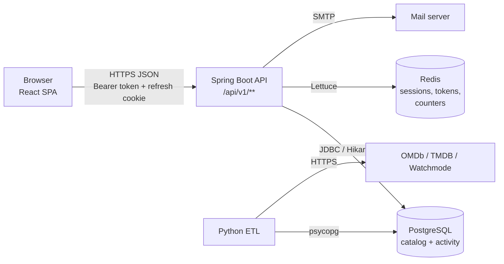
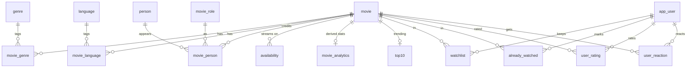
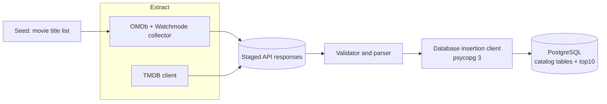

# CineSmart 🎬

**A movie discovery platform for Canada: find what to watch, and where to watch it.**

CineSmart combines a catalog of movies (loaded by a Python ETL pipeline) with personal activity (watchlist, watched, ratings, likes) to power search, ranked lists and content-based recommendations. A modular Spring Boot API serves a React single-page app, on top of a relational PostgreSQL schema, with Redis holding short-lived security state.

| Layer | Technology |
|---|---|
| **Backend API** | Java 25, Spring Boot 4.1, Spring Security (JWT), Spring Data JPA + JDBC, Redis (Lettuce) |
| **Frontend** | React 19, TypeScript, Vite, TanStack Query, React Router 7, react-hook-form + Zod, Tailwind 4 + shadcn/Radix |
| **Database** | PostgreSQL (16 tables, `pg_trgm` fuzzy search) |
| **ETL** | Python 3.13, psycopg 3; sources: OMDb, TMDB, Watchmode |
| **Testing** | JUnit + Testcontainers, Vitest + MSW, Playwright (+ axe accessibility) |

---

## Table of contents

1. [What it does](#what-it-does)
2. [System architecture](#system-architecture)
3. [The backend (the complex part)](#the-backend)
4. [The frontend](#the-frontend)
5. [The relational database](#the-relational-database)
6. [The ETL pipeline](#the-etl-pipeline)
7. [Testing](#testing)
8. [Repository layout](#repository-layout)
9. [Getting started](#getting-started)
10. [Known limitations](#known-limitations)

---

## What it does

CineSmart answers three questions:

1. **What should I watch?** Trending titles, IMDb's best, community favourites, and personal "For You" recommendations with a reason for every pick.
2. **Where can I watch it in Canada?** Streaming, rental, purchase and free availability per platform.
3. **What have I watched, liked and want to watch?** A watchlist, a watched list, 1.0–10.0 ratings and like/dislike reactions.

| Visitor | Can do |
|---|---|
| **Anonymous** | Browse with genre/language/year filters, fuzzy search by title or person, view ranked lists, open movie details with Canadian availability and similar titles |
| **Registered and verified** | Everything above, plus watchlist, watched, ratings, reactions, "For You" recommendations, profile, change password/email |
| **Operator** | Runs the ETL to load the catalog and applies SQL migrations |

---

## System architecture



- The browser talks **only** to the API (and to poster image hosts).
- The API is the only component that touches Redis and SMTP.
- PostgreSQL has **two writers**: the API (user tables and derived analytics) and the ETL (catalog tables). The schema is therefore the contract between two programs.
- User activity reaches the public lists in two hops: activity tables → hourly batch → `movie_analytics` → *Top Rated* / *Most Liked*. Personal state (`userState`, card flags) is read live.

---

## The backend

The backend is the heart of the project: a **modular monolith** of about 5,200 lines of main code across 98 Java files, exposing **36 REST endpoints**. Most of its complexity is in the places where a real production API gets hard: sessions, abuse protection, ranking, and consistency across two data stores.

### Modular structure

Seven feature modules, each split as `api / application / domain / persistence` ("package by feature, then by layer"):

| Module | Responsibility |
|---|---|
| `identity` | Accounts, email verification, login, sessions, password and email flows |
| `catalog` | Movie details, cards, genres, languages |
| `discovery` | Browse, fuzzy search, ranked lists, composed home page |
| `activity` | Idempotent watchlist/watched/rating/reaction writes and lists |
| `recommendation` | "For You" and "More like this" |
| `analytics` | Hourly batch that derives rating statistics |
| `shared` | Security config, rate limiting, Redis helpers, error model, paging |

Module dependencies stay acyclic through **dependency inversion**. `catalog` needs per-user flags that live in `activity`, so the interface `UserMovieStateLookup` lives in `shared` and `activity` implements it. `discovery` needs the "For You" row, so `ForYouSource` is defined in `discovery` and implemented by `RecommendationService`.

### API surface

All routes are under `/api/v1`. Access is *public*, *optional JWT* (personalised if signed in) or *login required*.

| Area | Endpoints |
|---|---|
| **Auth** | `POST /auth/signup`, `/login`, `/refresh`, `/logout` |
| **Email and password** | `POST /auth/email/verify`, `/email/resend`, `/email/change`, `/email/change/confirm`, `/password/forgot`, `/password/reset`, `/password/change` |
| **Profile and lists** | `GET /me`, `/me/watchlist`, `/me/ratings`, `/me/watched`, `/me/reactions` |
| **Activity** | `PUT`/`DELETE /movies/{id}/watchlist`, `/watched`, `/rating`, `/reaction` |
| **Catalog** | `GET /movies/{id}`, `/genres`, `/languages` |
| **Discovery** | `GET /movies`, `/movies/search`, `/movies/trending`, `/top-rated`, `/most-liked`, `/imdb-top-250`, `/home` |
| **Recommendation** | `GET /recommendations`, `/movies/{id}/similar` |

The human-written API contract is [`frontend-contract.md`](frontend-contract.md). Every error uses one uniform body with a machine-readable `ErrorCode`.

### Authentication and session security

This is the most intricate part of the system.

- **Two-token design.** A short-lived **access token** (HS256 JWT, 15 min) is held in JS memory only and sent as a Bearer header. A **refresh token** (random 256-bit value) lives only in an `HttpOnly; Secure; SameSite=Strict; Path=/api/v1/auth` cookie.
- **Refresh-token rotation with reuse detection.** Each refresh atomically consumes the token (`GETDEL`) and issues a new one. If an already-rotated token is presented again, the system treats it as theft and **revokes every session** for that user.
- **Sliding and absolute lifetimes.** Sessions expire after 2 h idle and 7 days absolute.
- **Revocation without a database lookup per token.** Logout blacklists the access token. Password change/reset sets a per-user `tokens-valid-after` timestamp that rejects every older token. Raw tokens are never stored; Redis keys are SHA-256 hashes.
- **Login hardening.** The login check order is fixed: IP block → user lock → credentials → verification. Unknown usernames run a dummy BCrypt check to **equalise timing**, and are counted and locked like real ones so a lock cannot reveal whether an account exists. Five failures lock a user for 1 h; ten block an IP.
- **Atomic counters.** Lockout and rate-limit counters use Redis **Lua scripts** (`INCR` + `EXPIRE` as one step) so a crash can't leave a counter without a TTL.
- **No IDOR by construction.** No endpoint accepts a user ID. Every query is keyed by the `userId` claim in the verified token.
- **Anti-enumeration.** Forgot-password and resend-verification return identical responses whether or not the account exists.
- **CORS and CSRF.** Exact-origin allowlist with credentials. CORS headers are applied before the rate-limit and auth filters, so even a 401 or 429 is readable by the SPA. The refresh cookie is `SameSite=Strict` and path-scoped, which justifies disabling CSRF tokens for this design.

### Rate limiting and Redis failure policy

- **Per-IP limits** (servlet filter): login 10/min, account actions 5/15 min, token actions 10/15 min, public reads 120/min.
- **Per-user limits** (MVC interceptor): writes 60/min, reads 120/min.
- `Retry-After` is returned on every 429 and surfaced by the frontend as a countdown.
- **Every Redis dependency has an explicit failure mode**:

  | Feature | When Redis is down |
  |---|---|
  | Login, refresh, signup, email/password flows | **Fail closed** (503): lockout and tokens can't be trusted |
  | Access-token revocation check | **Fail open**: availability over instant revocation, bounded by the 15-minute token life |
  | Rate limiting | **Fail open** |

  This is tested by pausing the Redis container through the Docker API.

### Search, ranking and recommendations

- **Fuzzy search.** PostgreSQL trigram word-similarity (`pg_trgm`, GIN indexes) over titles *and* people. Matches are scored, a title match gets a boost, and the best score per movie wins. It tolerates typos.
- **Ranked lists.** *Trending* (ETL-fed `top10`), *Top Rated by Users* and *Most Liked* (from batch analytics), *IMDb Top 250* (vote threshold, capped).
- **Bayesian weighted rating.** The hourly job computes `(v/(v+m))·R + (m/(v+m))·C`, as IMDb does, so two 10/10 ratings do not outrank fifty 9/10 ratings. It runs as **one** `INSERT … SELECT … ON CONFLICT DO UPDATE` over all movies, guarded by a Postgres **advisory lock** so multiple instances don't collide. A failed run rolls back and keeps the previous values.
- **De-duplicated home page.** Each row fetches extra candidates and drops movies already shown, so every row gets fresh titles. All cards are built in one batched call.
- **Content-based "For You".**

  ```mermaid
  flowchart LR
      S[Signals: watchlist, watched,<br/>ratings, likes, dislikes] --> W[Weigh<br/>rating ≥8→3, 7–7.9→2, like→2,<br/>watched/watchlist→1<br/>×1.5 if within 90 days]
      W --> C{≥ 3 signal movies?}
      C -- no --> CS[Cold start:<br/>Top Rated ∪ IMDb Top 250]
      C -- yes --> P[Profile: weights flow to<br/>genres, languages, actors, directors]
      P --> Q[SQL candidates ≤ 300<br/>excluding anything already acted on]
      Q --> SC["Score = 0.4·genre + 0.3·people<br/>+ 0.1·language + 0.2·imdb/10"]
      SC --> R[Reason per pick:<br/>person › liked movie › genre]
  ```

  Every recommendation carries a human-readable reason ("More with Christopher Nolan", "Because you liked Inception"). Ties break deterministically, so pages are stable. The same scorer powers "More like this".

### Persistence and data access

- **Two persistence styles, chosen per need.** `app_user` uses **JPA/Hibernate** (with `ddl-auto=validate`). Everything else uses hand-written SQL via `NamedParameterJdbcTemplate`, with all values bound as parameters.
- **No N+1 queries.** Loading any number of movies runs a fixed **five queries** (cores, genres, languages, availability, people), then assembles results in request order.
- **Idempotent writes.** Activity uses `ON CONFLICT` upserts. A repeated `PUT watchlist` keeps its original `added_at`; deleting a missing row is a no-op. Each write returns the user's new state **read inside the same transaction** (read-your-writes).
- **Deliberate transaction boundaries.** Signup commits the user *before* sending email, so a slow or failing SMTP never holds a DB transaction open or rolls back a valid account.
- **Cross-store consistency.** PostgreSQL and Redis can't share a transaction. The code orders operations so failures land in a safe state (for example, a Redis availability check before any signup write).

### Java and Spring techniques in use

Records for every DTO and config object (with compact constructors that fail fast on bad config), enums with behaviour, exhaustive `switch` expressions, text blocks for SQL and Lua, generics, and a centralised `@RestControllerAdvice` that maps typed exceptions to the uniform error body. Spring Security runs a custom bearer-token resolver so optional-auth routes degrade to anonymous on a bad token instead of failing.

---

## The frontend

A React 19 + TypeScript single-page app built with Vite. Design priorities: **correct session handling, cache consistency, and accessibility**.

- **Routing.** React Router 7 data router with lazy-loaded pages. Guards (`RequireAuth`) are layout routes. They are a convenience only; the server enforces access.
- **Server state.** TanStack Query with query keys scoped per viewer, so signing out or switching accounts can't leak cached data.
- **Optimistic updates.** Watchlist, rating and reaction changes update every cached copy of a movie card immediately, then apply the server's returned state (or roll back).
- **Session management.**
  - The access token is kept **in memory only** (never in Web Storage).
  - A timer refreshes it 60 s before expiry.
  - Refresh requests are **single-flight** and serialised across tabs with the **Web Locks API**. This matters because the backend treats a duplicate refresh as token theft.
  - **BroadcastChannel** syncs login/logout across tabs.
- **Single HTTP layer.** `api/http.ts` is the only place that calls `fetch`. It attaches the token, parses the uniform error body into a typed `ApiError`, and retries once after a refresh on 401.
- **Forms.** react-hook-form + Zod, with server errors mapped back onto fields. Client validation never replaces server validation.
- **UI.** Tailwind 4 with shadcn/Radix primitives; poster rows with infinite-scroll pagination; reason chips on recommendations; rate-limit countdowns driven by `Retry-After`.
- **Accessibility.** Route-change focus announcements and automated axe checks against WCAG 2.2 AA in the e2e suite.

---

## The relational database

PostgreSQL holds both the movie catalog and all user activity in a normalised schema of **16 tables**. The authoritative file is [`Cinesmart_database_schema.sql`](Cinesmart_database_schema.sql), with notes in [`Cinesmart_database_schema_info.md`](Cinesmart_database_schema_info.md).



| Group | Tables | Owner |
|---|---|---|
| **Catalog** | `movie`, `person`, `movie_role`, `movie_person`, `genre`, `language`, `movie_genre`, `movie_language`, `availability`, `top10` | ETL |
| **Users and activity** | `app_user`, `watchlist`, `already_watched`, `user_rating`, `user_reaction` | API |
| **Derived** | `movie_analytics` | Hourly batch job |

Design points:

- **Integrity in the database.** Composite primary keys give one rating/reaction/watchlist row per user and movie. Foreign keys cascade correctly, with `RESTRICT` on shared vocabularies. `CHECK` constraints bound years, ratings, runtimes and reaction values.
- **Case-insensitive uniqueness** for usernames and emails via unique expression indexes on `LOWER(...)`.
- **Fuzzy search indexes.** GIN trigram indexes on `LOWER(title)` and `LOWER(name)`.
- **Many-to-many modelling.** Genres, languages and people are link tables; credits carry a role (`Actor`, `Director`, `Writer`, …), which the API splits into cast and crew.
- **Redis complements Postgres.** Refresh sessions, email-link tokens, revocation lists, lockout counters and rate-limit windows live in Redis with TTLs, not in the relational schema.
- **Migrations are SQL files** applied by hand (no Flyway).

---

## The ETL pipeline

`Data_Ingestion/` is a Python 3.13 pipeline that builds and refreshes the catalog tables. The backend never calls these external APIs.



- **Extract.** Clients for **OMDb** (ratings, plot, posters), **TMDB** (details, credits) and **Watchmode** (Canadian streaming availability).
- **Transform.** A validator normalises and checks records before they reach the database.
- **Load.** An insertion client writes `movie`, `person`, `genre`, `language`, the link tables, `availability` and `top10` with PostgreSQL's `ON CONFLICT`, so re-runs are safe.
- **Configuration.** API keys and DB credentials come from environment variables; nothing is hard-coded.

Only `Data_Ingestion/Scripts/` and `Data_Ingestion/Logs/` are tracked in git.

---

## Testing

| Suite | Tooling | Scope |
|---|---|---|
| **Backend** | JUnit, MockMvc, **Testcontainers** | 191 tests in 29 classes. Runs against a throwaway `postgres:18-alpine` + `redis:7-alpine`, so your real database is never touched. Includes Redis-outage fault injection by pausing the container. |
| **Frontend unit** | Vitest, Testing Library, **MSW** | HTTP client, refresh coordination, session manager, query cache, components and pages. MSW mocks at the network layer so the real `http.ts` runs. |
| **End to end** | **Playwright** + axe | Runs against the real backend: browse/search, sign-up flow, watchlist → rate → sign-out, cross-session password change, rate-limit countdowns, WCAG 2.2 AA checks. |

See [`Cinesmart-Backend/test-results.md`](Cinesmart-Backend/test-results.md) for the latest recorded backend run.

---

## Repository layout

```
CineSmart/
├── Cinesmart-Backend/     Spring Boot API (Maven)
├── Cinesmart-Frontend/    React + Vite SPA (pnpm)
├── Data_Ingestion/        Python ETL (Scripts/, Logs/)
├── Analysis_Docs/         Deep technical analysis of the codebase
├── Cinesmart_database_schema.sql        Authoritative schema
├── Cinesmart_database_schema_info.md
├── CineSmart-Product-Requirements-and-System-Design.md
├── frontend-contract.md   API contract used by the frontend
├── frontend-plan.md
└── implementation-plan.md
```

For a chapter-by-chapter walkthrough of the architecture, request traces, security findings and improvement ideas, read [`Analysis_Docs/PROJECT_ANALYSIS.md`](Analysis_Docs/PROJECT_ANALYSIS.md).

---

## Getting started

### Prerequisites

JDK 25, Maven, Node 24 (`.nvmrc`) with pnpm, Python 3.13, PostgreSQL with the `pg_trgm` extension, Redis, and Docker (for backend tests).

### 1. Database

Create a database and apply [`Cinesmart_database_schema.sql`](Cinesmart_database_schema.sql). Enable `pg_trgm` if the script does not already.

### 2. Load the catalog (ETL)

```bash
cd Data_Ingestion
python -m venv .venv && source .venv/bin/activate   # Windows: .venv\Scripts\activate
pip install -r requirements.txt
# set DB_* and OMDB_API_KEY, TMDB_API_KEY, TMDB_API_TOKEN, WATCHMODE_API_KEY
python Scripts/Ingestion_Script.py
```

### 3. Backend

Copy the variables from `Cinesmart-Backend/.env.example` into your shell or run configuration:

| Variable | Purpose |
|---|---|
| `SPRING_DATASOURCE_URL` / `_USERNAME` / `_PASSWORD` | PostgreSQL connection |
| `JWT_SECRET` | Base64 of 32 random bytes |
| `MAIL_HOST` / `MAIL_PORT` / `MAIL_USERNAME` / `MAIL_PASSWORD` | SMTP (Ethereal works for development) |
| `REDIS_HOST` / `REDIS_PORT` | Redis (default `localhost:6379`) |
| `FRONTEND_BASE_URL` / `FRONTEND_ORIGINS` | Used for email links and CORS |
| `SPRING_PROFILES_ACTIVE=dev` | Optional: SQL logging and a non-`Secure` cookie for local HTTP |

```bash
cd Cinesmart-Backend
mvn spring-boot:run        # API on :8080
mvn test                   # needs Docker running
```

### 4. Frontend

```bash
cd Cinesmart-Frontend
cp .env.example .env.local   # set VITE_API_BASE_URL (e.g. http://localhost:8080/api/v1)
pnpm install
pnpm dev                     # app on :5173
pnpm test                    # unit tests
pnpm test:e2e                # Playwright, needs the backend running
```

> The refresh cookie is `SameSite=Strict`, so in production the SPA and the API must share a registrable domain.

---

## Known limitations

Documented honestly in the analysis, so contributors know where the edges are:

- Database migrations are applied **manually**; there is no Flyway/Liquibase.
- There is **no Docker, CI or deployment configuration** in the repository yet.
- Recommendations are **recomputed on every request** (no cache).
- Passwords longer than 72 bytes can hit BCrypt's limit and cause a server error (analysis finding S-1).
- The ETL inserts movies with `ON CONFLICT DO NOTHING`, so IMDb ratings and votes are not refreshed on re-runs.
- Public list statistics update **hourly**, not instantly (the UI says so).

---

*Built as an end-to-end study in full-stack engineering: a secure, well-tested API, a careful SPA, a relational core, and a data pipeline that feeds it.*
